# AI Content Factory

**A local-first platform for researching, scripting and clipping short-form video, with a person approving every step that matters.**

AI Content Factory is a set of connected engines, not a one-click video generator. One pipeline turns research into
evidence-checked, reviewed scripts. Another turns long footage into reviewed short clips: import, transcription, AI moment
discovery, quality filtering, FFmpeg rendering and review. A persistent job queue and an optional autonomous mode tie them
together. It runs on one Windows computer, with no local AI models, no GPU requirement and no paid services.

> **Notice:** This repository contains public-facing product documentation and visual materials only. The application's source code is maintained separately in a private repository.

| | |
|---|---|
| **Status** | Version 0.3.0, under active development; not publicly released |
| **Platform** | Windows, localhost only |
| **Evidence date** | Documentation checked against the private repository and a running copy on 2026-11-25 |
| **Source code** | Private |

---

## The problem

Short-form video at scale is slow and risky. Research is manual, AI-written scripts can state things the sources never said,
finding the best 30 seconds in an hour of footage means scrubbing through all of it, and unattended automation raises questions
of rights, platform terms and cost. The hard part is automating the mechanical work without losing accuracy, control or
accountability.

## The solution

- **Evidence-checked content.** Claims carry a source and a verbatim quote that code verifies; only usable facts reach a script.
- **Moments, not guesses.** Transcripts are analysed for scored, timestamped candidates with the reason for each; the model never
  writes timestamps.
- **Local, validated rendering.** Clips are cut with FFmpeg on the user's computer and checked against the plan before they are
  accepted.
- **Human approval.** Everything lands in a review queue. Nothing is published, uploaded or sent to an external service without an
  explicit decision.
- **Resilient by design.** A persistent queue survives restarts, with retries, pause, cancel and recovery.

## Main capabilities

| Capability | Status |
|---|---|
| Channels, niches, research runs, source-quoted claims, versioned script review | Implemented |
| Campaign records for creator-authorised clipping | Implemented |
| Footage import and media library (hash, validate, thumbnail, duplicate detection, rights record) | **Implemented, verified live** |
| Clip rendering with FFmpeg and in-page review | **Implemented, verified live** |
| Transcription (Groq Whisper) and AI moment discovery | Implemented; verified with test doubles, **no live provider call made** |
| Autonomous mode: scheduler, source adapters, selection rules, quality filter | Implemented; folder discovery **verified live**; the full automatic run was not run (needs a provider key) |
| Gemini and Groq provider layer: fallback, quotas, circuit breakers | Implemented; test doubles only |
| Direct-link and RSS acquisition | Implemented and mock-tested; **not run live** |
| YouTube | Link validation and metadata only. **No download, by design** |
| Captions, reframing, export, publishing, other platforms | **Not built** |

## Screenshots

Genuine screenshots from the running application, using synthetic footage and no API keys. The transcript and moment-candidate
screens display **synthetic sample records** (no AI provider was called); import, rendering, preview and approval are real.
Provenance and gaps are in [`screenshots/README.md`](screenshots/README.md).

| | |
|---|---|
| 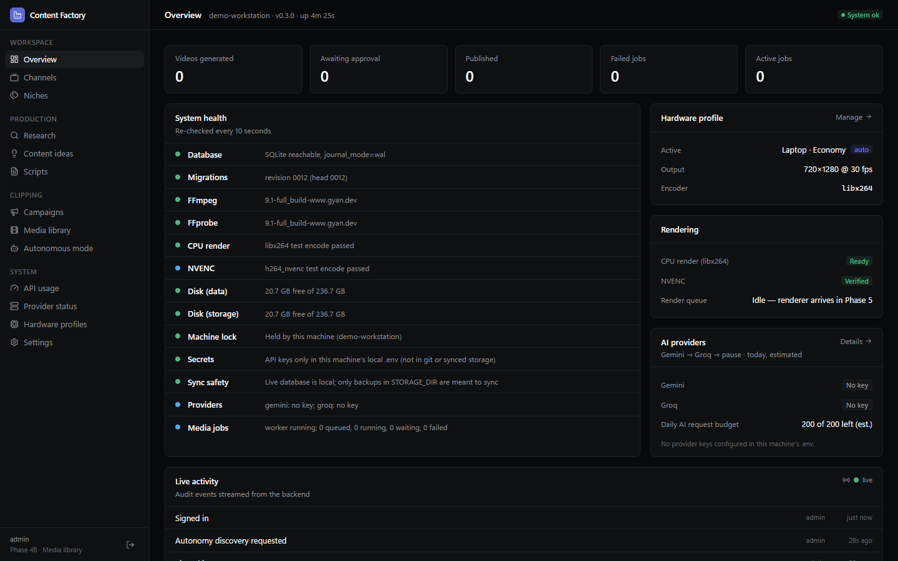 **Overview.** Health checks, migrations at head, hardware profile and provider status. | 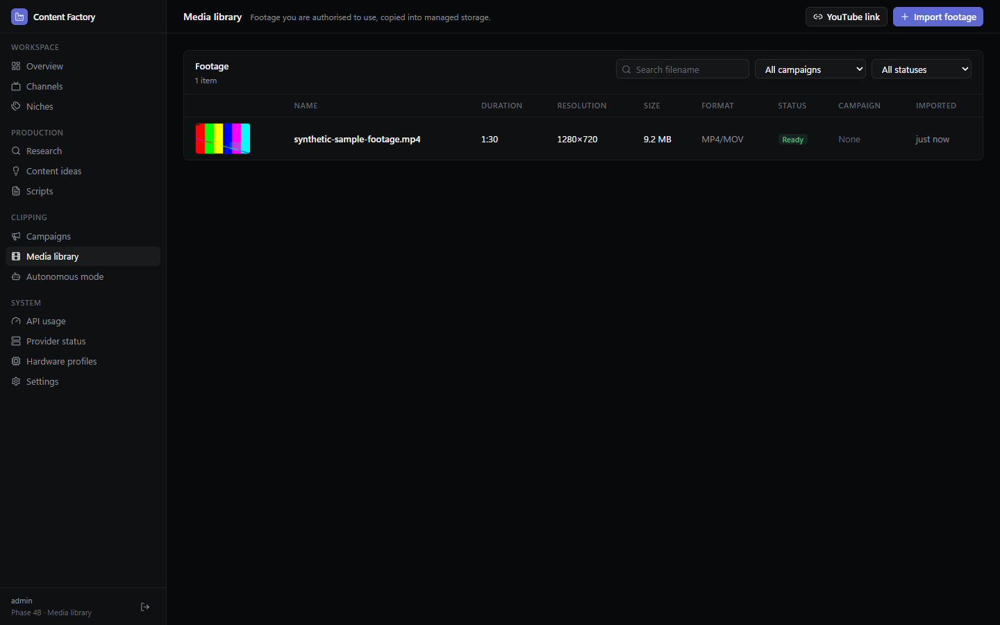 **Media library.** A real import: thumbnail, duration, resolution, size, status. |
| 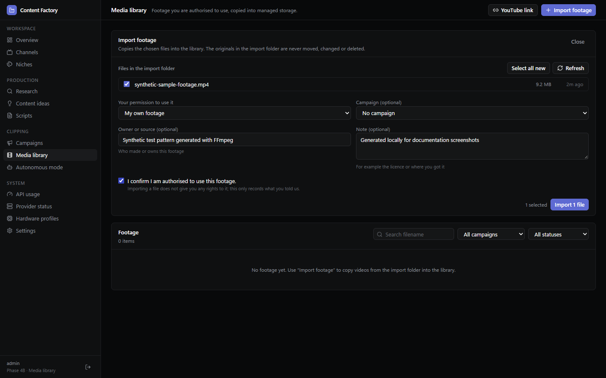 **Import.** Files come from an import folder; rights are stated explicitly and kept separate from consent. | 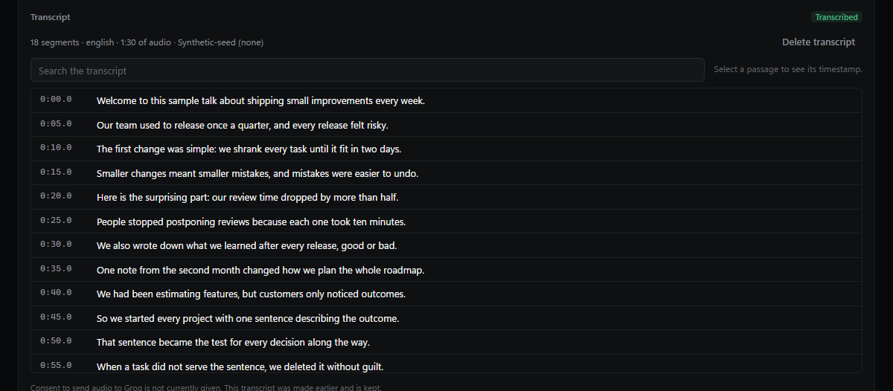 **Transcript** (synthetic sample). Timestamped segments. |
| 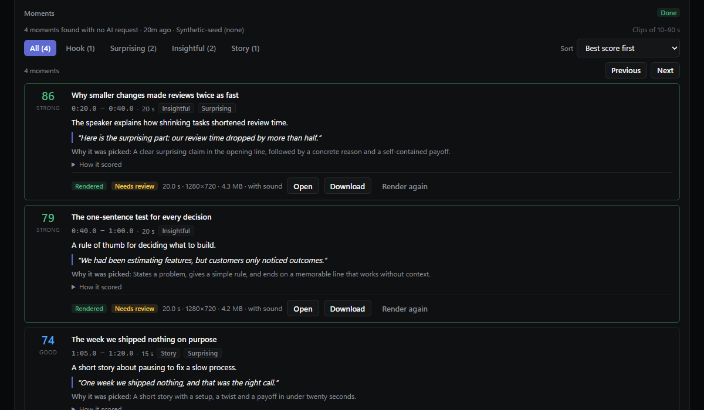 **Moment discovery** (synthetic sample). Score, categories, suggested opening and why each was picked. | 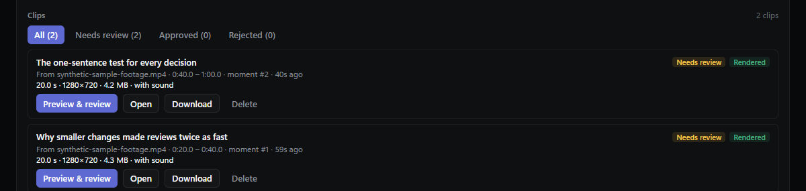 **Clips.** Real FFmpeg renders with review state, size, resolution and sound. |
| 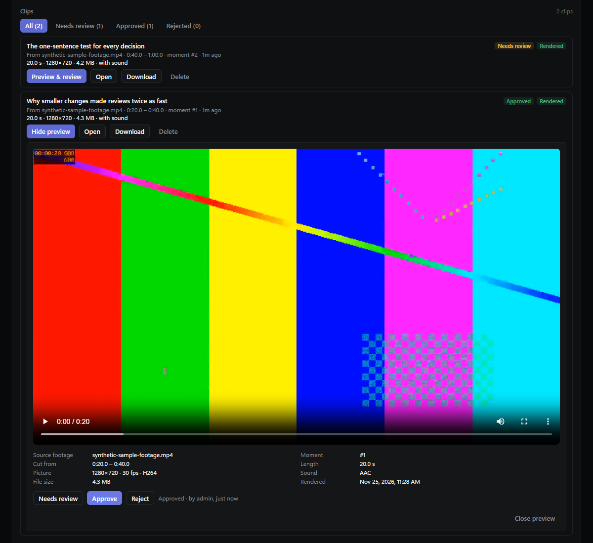 **Clip review.** In-page preview of a real render and an approve, reject or needs-review verdict. | 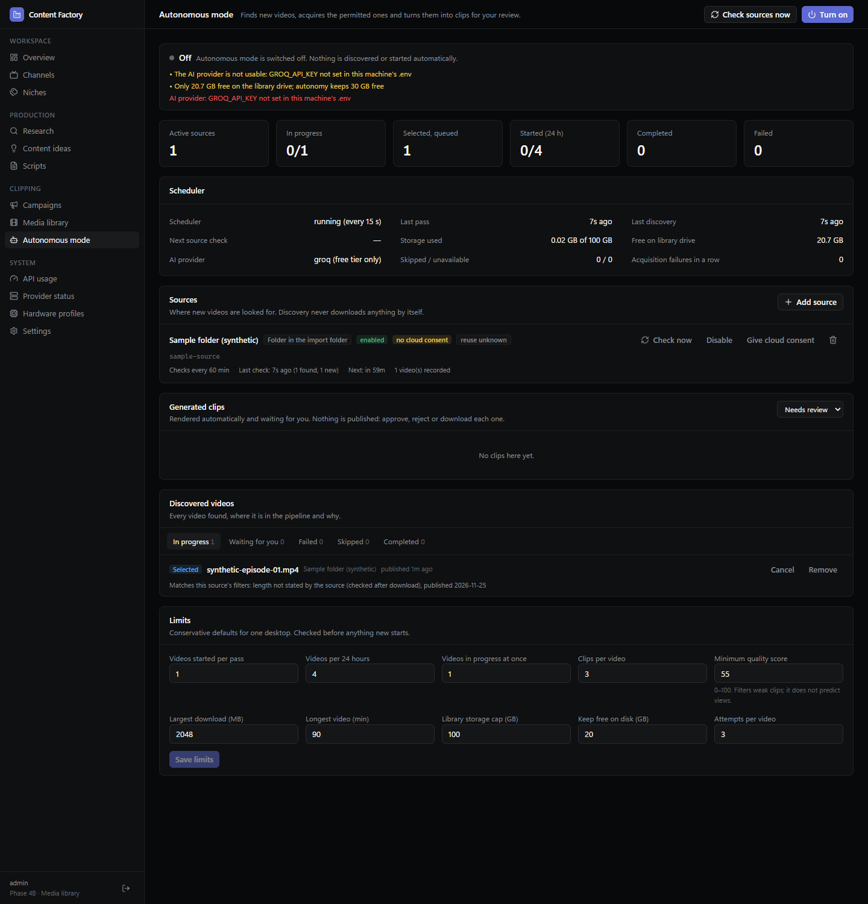 **Autonomous mode.** Scheduler, limits, blockers and a discovered video. |
| 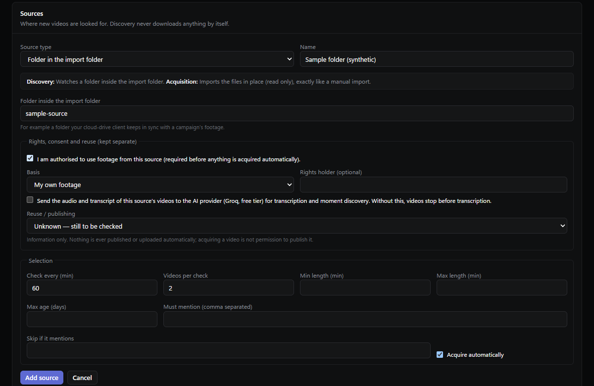 **Adding a source.** Rights, cloud consent and reuse status are separate; selection rules per source. | 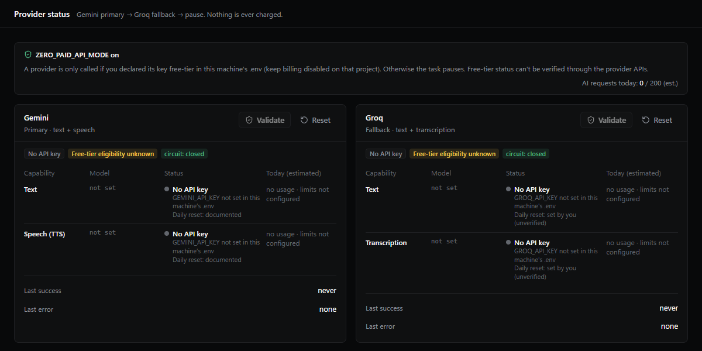 **Provider status.** Gemini primary, Groq fallback, then pause; circuit state; zero-paid-API mode. |

## Architecture overview

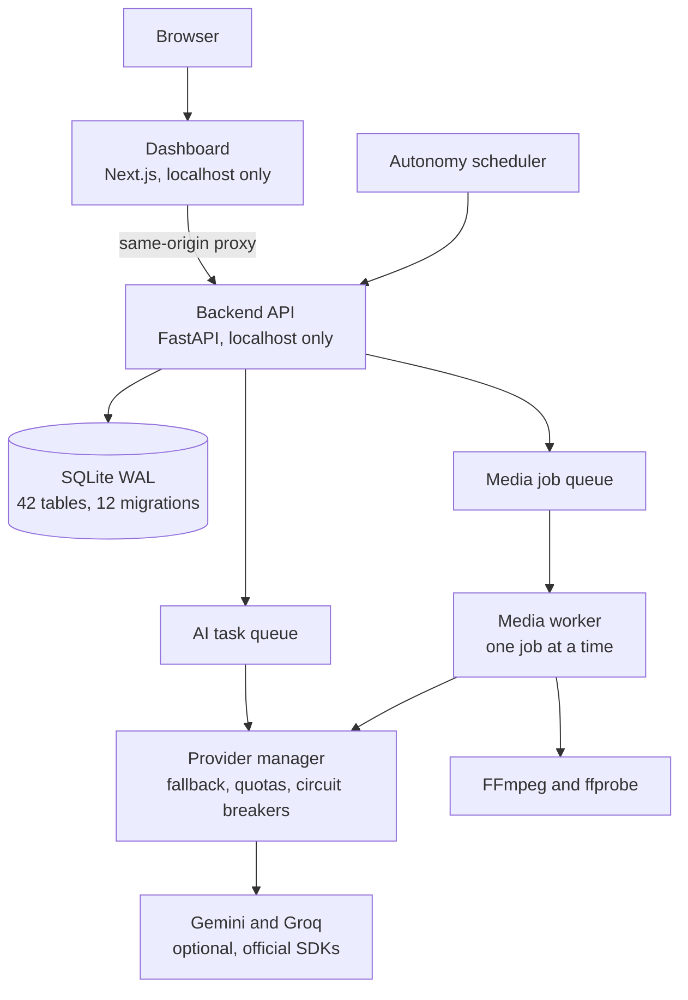

Six detailed diagrams (system, acquisition, processing, job lifecycle, provider fallback, autonomous orchestration) are in
[`architecture/`](architecture/README.md).

### The engines

| Engine | Responsibility |
|---|---|
| Provider and quota | One interface to Gemini and Groq; fallback, retry, quotas, circuit breakers |
| Research and claim verification | Topic collection, polite fetching, source-quoted claims checked in code |
| Script | Versioned scripts that cite fact ids, deterministic checks, approval rules |
| Media library | Import, validation, content-addressed storage, rights record |
| Transcription | Chunked audio, provider transcription, per-footage consent |
| Moment discovery | Windowed transcript analysis, local validation, transparent scoring |
| Clip rendering | Exact re-encoded cuts validated against the plan |
| Source acquisition | Provider contract and planner; plain-HTTP and local routes |
| Autonomy | Source discovery, selection, quality filtering, orchestration |

## Technology stack

| Layer | Technology |
|---|---|
| Backend | Python, FastAPI, SQLAlchemy, Alembic migrations |
| Database | SQLite in WAL mode |
| Dashboard | Next.js, React, TypeScript, Tailwind CSS |
| Media | FFmpeg and ffprobe |
| AI providers | Google Gemini and Groq through their official SDKs (optional, user's own keys) |
| Testing | pytest, Vitest, Playwright |
| Platform | Windows, localhost only |

## Engineering highlights

- **Two queues for two failure modes**: AI work pauses and resumes around quotas; media work is supervised, recoverable and
  one-at-a-time.
- **Invariants enforced by the database**: check constraints and partial unique indexes make half-imported files, duplicate
  ready content and double renders impossible.
- **Race-safe transitions**: every queue state change is a conditional update with explicit worker ownership.
- **Supervised FFmpeg** under a Windows job object, with timeouts, stall detection and identity-checked orphan reaping.
- **No invented timestamps**: the model returns segment numbers, never times.
- **Validate the artefact, not the exit code**: rendered clips are probed and compared with the plan before acceptance.
- **Consent and rights kept separate**, with consent enforced three times in the backend and withdrawable at any time.
- **Honest about platform rules**: no YouTube downloader exists; discovery moved to the official API after a live
  `robots.txt` check.

## Testing and reliability

| Measure | Result |
|---|---|
| Dashboard unit tests (Vitest) | **22 files, 406 tests, all passed** (run 2026-11-25) |
| Backend suite (pytest) | **1,846 tests: 1,843 passed, 3 skipped, 0 failed** (run 2026-11-25; the skips need symlink privileges or a memory cap) |
| Backend test functions defined | 1,031 across 46 files |
| Playwright end-to-end specs | 2 spec files exist; **not run** in this review |
| Lint and type checks | Configured; **not run** in this review |
| Live provider calls | **None made** by the project or in this review |

Details, mocking strategy and boundaries: [`TESTING_AND_RELIABILITY.md`](documentation/TESTING_AND_RELIABILITY.md).

## Documentation

| Document | Contents |
|---|---|
| [Product overview](documentation/PRODUCT_OVERVIEW.md) | Vision, problem, users, capabilities, workflow, status |
| [System architecture](documentation/SYSTEM_ARCHITECTURE.md) | Frontend, backend, engines, database, orchestration, failure handling |
| [Media acquisition](documentation/MEDIA_ACQUISITION.md) | Exactly what works today, provider abstraction, downloading, import, validation |
| [Processing pipeline](documentation/PROCESSING_PIPELINE.md) | Ingestion, transcription, moments, quality filter, FFmpeg, storage |
| [Queue and orchestration](documentation/QUEUE_AND_ORCHESTRATION.md) | Job lifecycle, recovery, autonomous scheduling |
| [AI provider architecture](documentation/AI_PROVIDER_ARCHITECTURE.md) | Gemini and Groq, fallback, circuit breakers, quotas |
| [Testing and reliability](documentation/TESTING_AND_RELIABILITY.md) | Strategy, counts, mocking, boundaries |
| [Engineering decisions](documentation/ENGINEERING_DECISIONS.md) | Decisions, trade-offs, lessons |
| [Architecture diagrams](architecture/README.md) | Six Mermaid diagrams |
| [Screenshots](screenshots/README.md) | Provenance and gaps |

## Current implementation status

| Label | Items |
|---|---|
| **Verified live** | Import and library, clip rendering and review, folder-source discovery, health and provider-status pages, migrations at head |
| **Verified by tests** | Provider layer, queue and recovery, import, rendering, security hardening, acquisition planner (backend); dashboard components |
| **Implemented, not verified end to end** | Transcription and moment discovery against a real provider, research and scripting against real feeds, autonomous end-to-end run, direct-link and RSS downloads, YouTube metadata |
| **Partially verified** | Autonomous mode: discovery observed live, the automatic acquire-to-clip run not run; some interface wording from earlier development phases is out of date |
| **Not built** | Captions, reframing, export, publishing, voiceover, other platform providers, a dedicated Jobs page |

## Private source-code notice

The source code is private and is not published, mirrored or forked here. This repository contains only documentation,
diagrams and genuine screenshots. No license is granted for the material in this repository.
