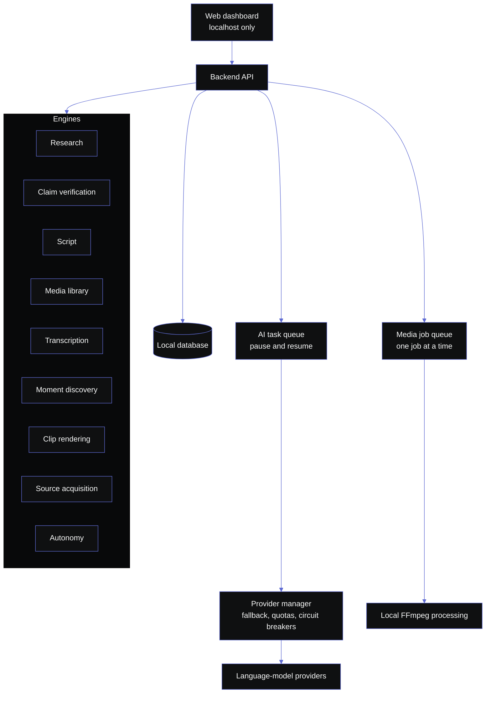
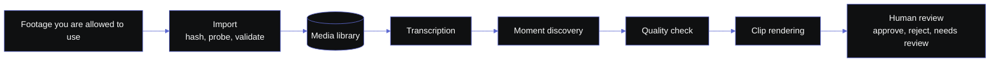

# AI Content Factory

**A local-first platform for researching, scripting and clipping short-form video, with a human approving every step that matters.**

> **Notice:** This repository contains public-facing product documentation and visual materials only. The application's source code is maintained separately in a private repository.

---

## Introduction

AI Content Factory is a local-first, API-first platform for producing YouTube Shorts across multiple channels. It covers two pipelines in one application:

1. **Research to script.** Collect topics, gather source material, extract claims with evidence, and draft scripts that may only use facts that have been checked.
2. **Footage to clips.** Import long-form footage you have the right to use, transcribe it, discover candidate moments, render clips and review them.

It runs on a Windows computer with no local AI models, no GPU requirement and no paid services. **Nothing is published without human approval.**

## The problem

Making short-form video at scale is slow and risky. Research is manual, AI-written scripts can state things the sources never said, and finding the best 30 seconds in an hour of footage means scrubbing through all of it. Automating this without losing control, accuracy or respect for source rights is the hard part.

## Product objectives

- **Human in the loop.** Approval is required before anything leaves the system.
- **Evidence-backed content.** Every claim in a script traces back to a retrieved source and a verbatim quote, checked by code, not just by the model.
- **Local-first.** Data and media stay on the user's computer. Audio or text is sent to an AI provider only with explicit per-item consent.
- **Zero paid API mode.** Providers are called only when the user declares a free-tier project, and over-quota requests pause rather than charge.
- **Respect for rights and platform terms.** Rights, acquisition capability and reuse status are tracked separately, and the platform never downloads from services whose terms forbid it.
- **Resilient by design.** Work survives crashes and restarts, and failures are visible and recoverable.

## High-level architecture

More diagrams are in [`architecture/`](architecture/).

## The engines

| Engine | Role |
|---|---|
| **Provider and quota engine** | A common interface to language-model providers with fallback order, retry rules, circuit breakers, response caching, and persistent daily and per-minute quotas. |
| **Research engine** | Collects topics from configured feeds, de-duplicates them across channels, fetches article text politely, and pre-scores ideas. |
| **Claim-verification engine** | Extracts claims with a source and a verbatim quote, then checks them in code. Claims are classified as multi-source match, source supported, human verified, needs review, unverified, AI assumption or rejected. Only usable facts reach a script. |
| **Script engine** | Generates versioned scripts that cite fact ids, runs deterministic checks, and supports edit, regenerate and approve. Any change supersedes earlier approvals. |
| **Media library engine** | Imports footage with hashing, duplicate detection and format validation, and records the user's declared rights. |
| **Transcription engine** | Splits audio and produces timestamped transcripts through a provider, with per-footage consent. |
| **Moment-discovery engine** | Reads transcripts (text only) and proposes scored, timestamped clip candidates with a title, an opening line and the reason for the pick. |
| **Clip-rendering engine** | Cuts approved moments locally with FFmpeg, validates the output, and serves previews for review. |
| **Source-acquisition engine** | A provider contract that decides how a source may be obtained. See the limits below. |
| **Autonomy engine** | An optional background mode that discovers videos from configured sources, applies selection rules and a local quality check, and queues finished clips for review. |
| **Campaign management** | Manual records of creator-authorised clipping campaigns and their rules. |

## Media acquisition and processing workflow

How footage can arrive:

| Route | State |
|---|---|
| Files placed in the import folder | Working |
| Direct video links and sources the user configures in autonomous mode | Implemented; downloads happen only where plain, permitted HTTP access exists |
| YouTube links | **Metadata only.** Videos are never downloaded. The request waits for a video file the user supplies |
| Other platforms (for example Twitch, Instagram, TikTok) | **Not built** |

## Transcription and moment discovery

- Audio is cut into pieces and transcribed through a provider, only with the user's per-footage consent, which can be withdrawn at any time.
- Moment discovery sends the transcript text only (never video or audio) and returns candidates with scores and reasons. Results are not re-analysed unless the user asks.

## Clip generation

Clips are cut locally with FFmpeg into standard H.264 and AAC files, checked after rendering, and kept in the library. Each clip can be previewed in the dashboard and given a verdict (approved, rejected or needs review) that is stored separately from its render status.

## Queue and orchestration architecture

- **Two queues.** An AI task queue for provider calls, and a media job queue for local FFmpeg work.
- **AI tasks pause instead of failing.** If no provider may serve a task, it is saved with the reason and the earliest resume time, and a background worker resumes it.
- **Media jobs are supervised.** One job runs at a time, with progress, cancel, retry, timeouts, stall detection, whole-process-tree termination and recovery after a restart.
- **Observability.** Job transitions are logged, and the dashboard shows queue health, stuck-job suspicions and recent failures by category.

## Technology stack

| Layer | Technology |
|---|---|
| Backend | Python, FastAPI, SQLAlchemy, Alembic migrations |
| Database | SQLite in WAL mode |
| Dashboard | Next.js, React, TypeScript, Tailwind CSS |
| Media | FFmpeg and FFprobe |
| AI providers | Google Gemini and Groq through their official SDKs |
| Testing | pytest, Vitest, Playwright |
| Platform | Windows, localhost only |

## Screenshots

Real dashboard, workflow and processing screenshots will be added once they have been reviewed for personal data. Nothing here is a mock-up presented as the working product.

| Screen | Status |
|---|---|
| Overview and system health | _Placeholder, screenshot to be added_ |
| Research and content ideas | _Placeholder, screenshot to be added_ |
| Script review | _Placeholder, screenshot to be added_ |
| Media library | _Placeholder, screenshot to be added_ |
| Transcript and moments | _Placeholder, screenshot to be added_ |
| Clip preview and review | _Placeholder, screenshot to be added_ |
| Autonomous mode | _Placeholder, screenshot to be added_ |

See [`screenshots/`](screenshots/).

## Demonstration

A walkthrough video will be linked here.
_Placeholder, link to be added._ See [`demonstrations/`](demonstrations/).

## Current development status

The project is **under active development** and not publicly released.

| Area | State |
|---|---|
| Foundation: local API, database, hardware and FFmpeg detection, backups | Completed |
| Admin authentication and provider layer | Completed |
| Research, claim verification and script review | Completed |
| Campaign records | Completed |
| Media job queue, footage import and media library | Completed |
| Transcription | Completed |
| AI moment discovery | Completed |
| Clip rendering and clip review | Completed |
| Security hardening and observability | Completed |
| Autonomous mode | Implemented; under continued testing, limited to sources with a permitted way to obtain files |
| Source links (YouTube) | Link validation and metadata only; no download by design |
| Captions and reframing | Not built |
| Export and publishing | Not built |
| Providers for other platforms | Not built |

## Private source-code notice

The source code is private and is not published, mirrored or forked in this repository. This repository only holds documentation, diagrams and visual materials.
