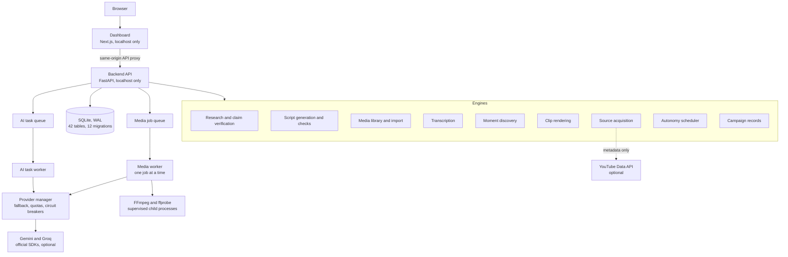
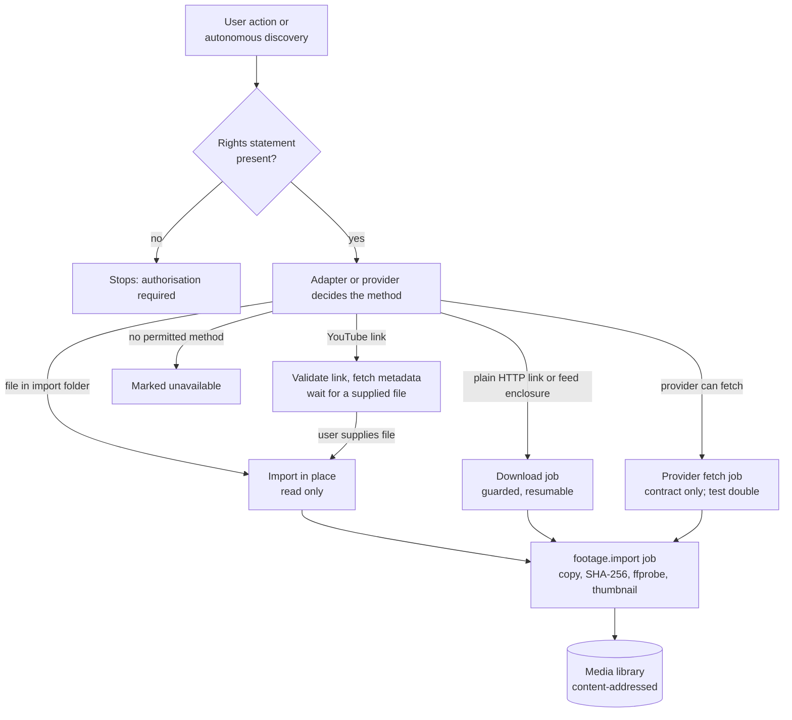
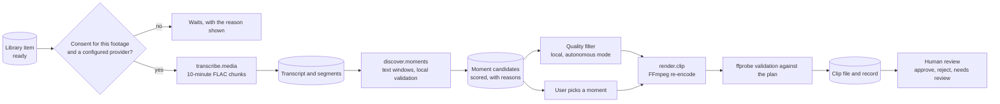
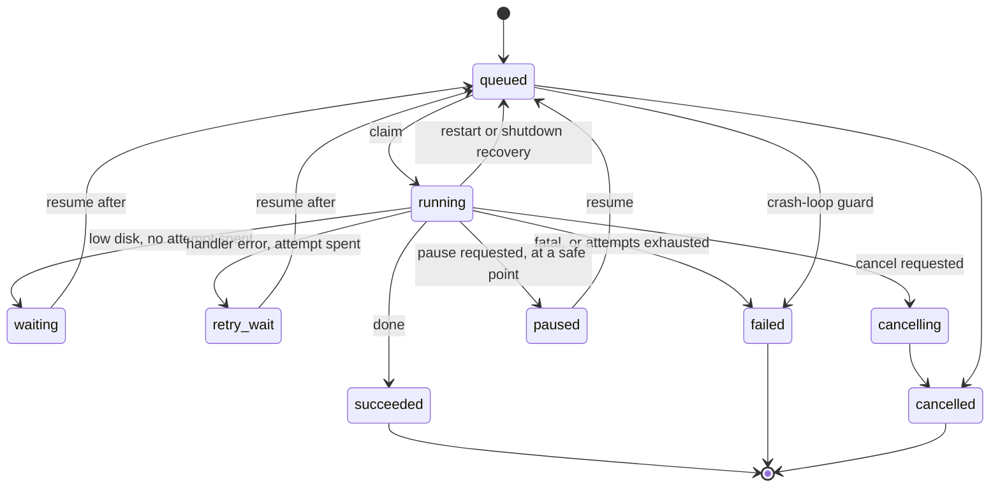
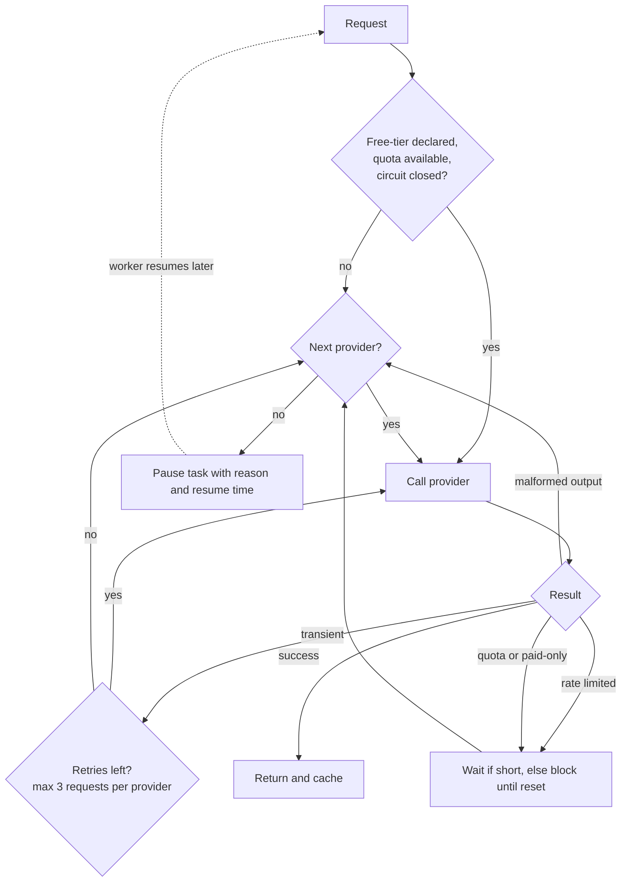
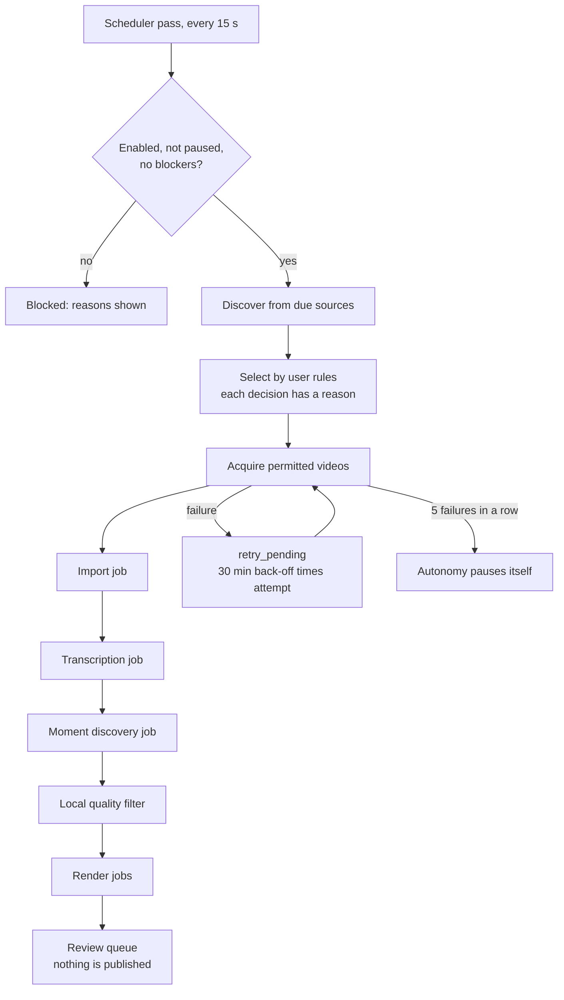

# Architecture

Sanitised diagrams of the architecture **implemented today** in the private repository (version 0.3.0, inspected 2026-11-25).
They show components and flow, not code. Where a connection is not built, the diagram does not draw it.

| Diagram | Section |
|---|---|
| Overall system architecture | [1](#1-overall-system-architecture) |
| Media acquisition workflow | [2](#2-media-acquisition-workflow) |
| Media processing workflow | [3](#3-media-processing-workflow) |
| Queue and job lifecycle | [4](#4-queue-and-job-lifecycle) |
| AI provider fallback | [5](#5-ai-provider-fallback) |
| Autonomous orchestration | [6](#6-autonomous-orchestration) |

Written explanations: [SYSTEM_ARCHITECTURE](../documentation/SYSTEM_ARCHITECTURE.md),
[MEDIA_ACQUISITION](../documentation/MEDIA_ACQUISITION.md), [PROCESSING_PIPELINE](../documentation/PROCESSING_PIPELINE.md),
[QUEUE_AND_ORCHESTRATION](../documentation/QUEUE_AND_ORCHESTRATION.md),
[AI_PROVIDER_ARCHITECTURE](../documentation/AI_PROVIDER_ARCHITECTURE.md).

## 1. Overall system architecture

One computer, two processes, one database. The browser talks only to the dashboard, which proxies to the backend.

Not drawn because not built: a video-assembly engine, voiceover, captions, export, publishing, and providers for any platform
other than YouTube (metadata only).

## 2. Media acquisition workflow

Status: manual import and folder-source discovery verified live; links, feeds and channel discovery tested with mocks only;
YouTube download does not exist by design; other platforms not built.

## 3. Media processing workflow

## 4. Queue and job lifecycle

## 5. AI provider fallback

Text chain: Gemini, then Groq, then pause. Transcription and moment discovery use Groq only, restricted to the provider the user
consented to.

## 6. Autonomous orchestration

The scheduler creates ordinary jobs through the existing services; it does no media work itself. Only the discovery step was
observed running in this review.
