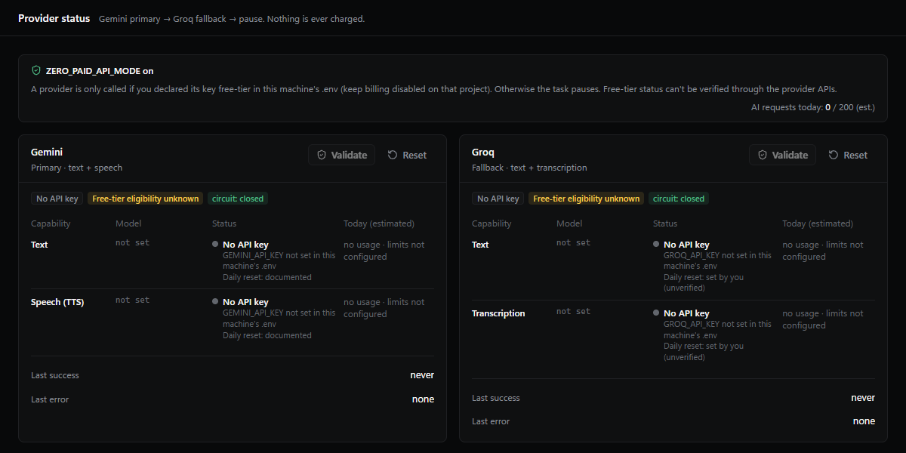
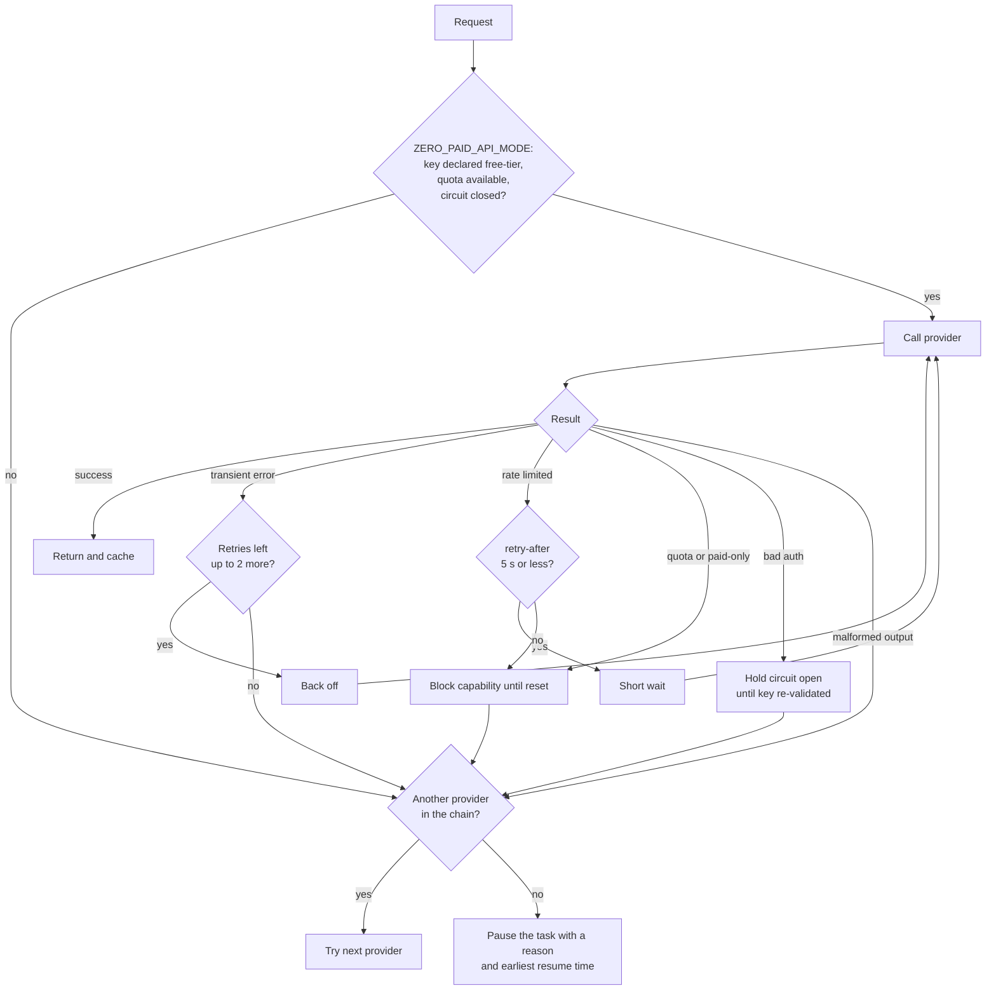

# AI provider architecture

How AI Content Factory talks to language-model and speech providers: abstraction, fallback, circuit breaking, quotas and
failure recovery. Based on the private repository and its verification records (inspected 2026-11-25).

> **What has and has not been verified.** The provider layer is covered by automated tests that use the real SDKs' exception
> classes over mocked transports and scripted fake providers. The project's own verification record (2026-11-17) states that
> **no real provider request had ever been sent**, and **no provider key was configured or used for this review**. The
> behaviour below is therefore *implemented and tested against fakes*, not observed against Gemini or Groq. The Provider
> status page screenshot shows the layer running with no keys.

## 1. Provider abstraction

- Three interfaces: a **text provider** (plain and structured JSON generation, and analysis of untrusted content), a
  **speech-synthesis provider** and a **transcription provider**. Each provider declares which capabilities it supports.
- A common **error taxonomy** (transient, rate-limited, quota or paid-only, authentication failed, invalid request, malformed
  response) decides what happens next: retry, fall back, block the capability, or fail.
- **Two adapters**, each built on the vendor's official SDK, with SDK-level retries switched off so that every request that
  leaves the machine is visible to and counted by the manager:

| Provider | Capabilities implemented |
|---|---|
| **Google Gemini** | Text, structured JSON, analysis of untrusted content, speech synthesis (saved to WAV) |
| **Groq** | Text, structured JSON, optional transcription (Whisper models) |

- Model identifiers are **configuration, not code**: the model for each capability comes from the machine's `.env`, is
  recorded on every result, and the documentation tells the user to copy current identifiers from the provider's console
  because they change.
- An **offline fake provider** exists for development and tests, so nothing needs a network.

## 2. Fallback behaviour

For text tasks the chain is **Gemini (primary), then Groq (fallback), then pause**. Transcription uses Groq only.

Two stage-specific exceptions to the chain exist **for privacy**: moment discovery and autonomous processing are restricted to
the one provider the user consented to for that footage, so transcript text can never fall back to a provider the user did
not agree to.

## 3. Circuit breakers

| Property | Behaviour |
|---|---|
| Opens | After three consecutive transient or malformed-response failures (configurable) |
| Cooldown | Starts at 60 seconds, **doubles** on each re-open, capped at 15 minutes |
| Half-open | After the cooldown, exactly **one** caller holds the recovery probe; others are turned away and their tasks re-poll shortly |
| Probe success | Closes the circuit and resets the failure state |
| Probe failure | Re-opens with the next, capped cooldown |
| Bad credentials | Held open until an administrator resets or re-validates the key |
| Safety | A probe reservation is always released, even when the request ends without a verdict, and expires as a last resort; each reservation has an owner token so a late release cannot free a newer probe |
| Evidence | A real success or failure remains valid health evidence even if its probe reservation has expired |
| Disabled | A cooldown of zero or less disables the breaker |

## 4. Quotas and rate limits

- A **quota manager** keeps persistent daily counters plus per-minute and per-hour windows, and a global daily request cap
  (default 200 per day).
- Limits come from **the user's own configuration and are never invented**; the dashboard shows "limits not configured" until
  they are entered, and always labels remaining quota as an estimate.
- **Reset times** are handled honestly: Gemini's documented midnight-Pacific reset is used; Groq does not document its reset, so
  the default is *unknown*, enforced as a **rolling 24-hour window** (never more permissive than any fixed reset).
- **Zero paid API mode.** A provider is called only if the machine's `.env` declares its key free-tier. That flag is the
  user's declaration, not proof: neither provider exposes billing status through its API, so the dashboard labels it
  "declared by you (unverified)". The real safeguard is keeping billing disabled on the project that owns the key. Paid usage
  is not implemented; setting the mode to false does not unlock paid calls.
- A provider answer meaning "no free tier for this model" blocks that capability instead of being paid for.
- Every request is logged with request id, provider, model, task id, token counts, estimated cost, duration, status and error.
  Responses are cached (24 hours by default) and duplicate requests de-duplicated.

## 5. Failure recovery

Two retry budgets exist on purpose and are never merged:

1. **Provider-level retries** inside one call: transient errors are retried on the same provider up to twice (at most three
   requests per provider per call) with capped exponential back-off.
2. **Task-level attempts** (`ai_tasks`): three attempts, counted only for malformed output and unexpected errors, however many
   providers were tried. After the third the task fails permanently; between attempts it is paused for a growing delay.

**Pauses never consume attempts.** Rate limits, exhausted quotas, an open circuit, a recovery probe in flight or an unconfirmed
free tier only pause the task until the earliest known resume time, and a background worker resumes it. Nothing is lost on a
restart.

## 6. Model usage across pipeline stages

| Stage | Uses a model? | Provider(s) |
|---|---|---|
| Research brief (claims with source quotes) | Yes, as a provider task that can pause and resume | Gemini, then Groq |
| Claim verification | **No**: checked in code against retrieved text | None |
| Topic selection | Deterministic rules and scoring | None |
| Script generation and regeneration | Yes, structured output; only usable facts are offered | Gemini, then Groq |
| Script checks | **No**: deterministic | None |
| Speech synthesis (TTS) | Implemented in the adapter; disabled by default pending separate free-tier confirmation | Gemini |
| Transcription | Yes; audio, with per-footage consent | Groq only |
| Moment discovery | Yes; transcript text only, with consent | Groq only (no fallback) |
| Quality filter | **No**: local, deterministic | None |
| Clip rendering and review | **No** | None |
| Import, acquisition, autonomy scheduling | **No** | None |

Untrusted text (articles, transcripts) is only ever given to a model as delimited data with an instruction never to follow it,
and model output is re-checked by code before it can change anything.

## 7. Limits of what is verified

- No live call to Gemini or Groq has been made by this project or in this review.
- The exact shape of real provider error bodies is mapped from the SDKs' exception classes with representative bodies, not
  from live responses.
- Whether a given model identifier exists for a given project is checked only when the user presses **Validate**, which uses
  metadata calls and no generation quota.
- Free-tier eligibility and limits cannot be verified through the providers' APIs; the application states this in its interface.
