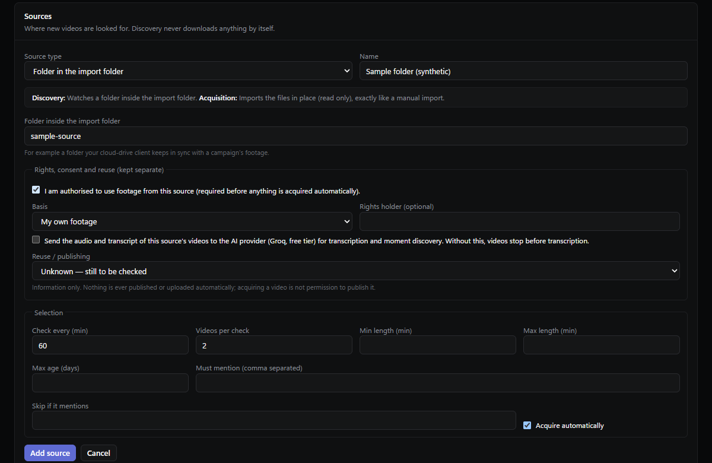
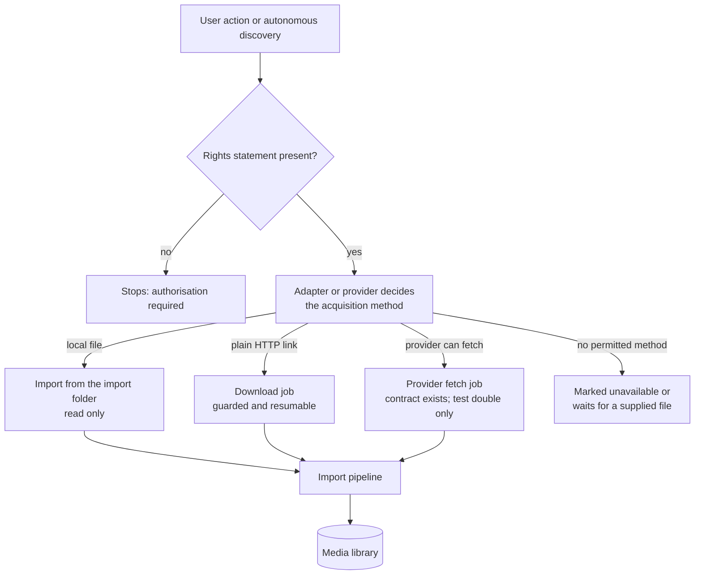
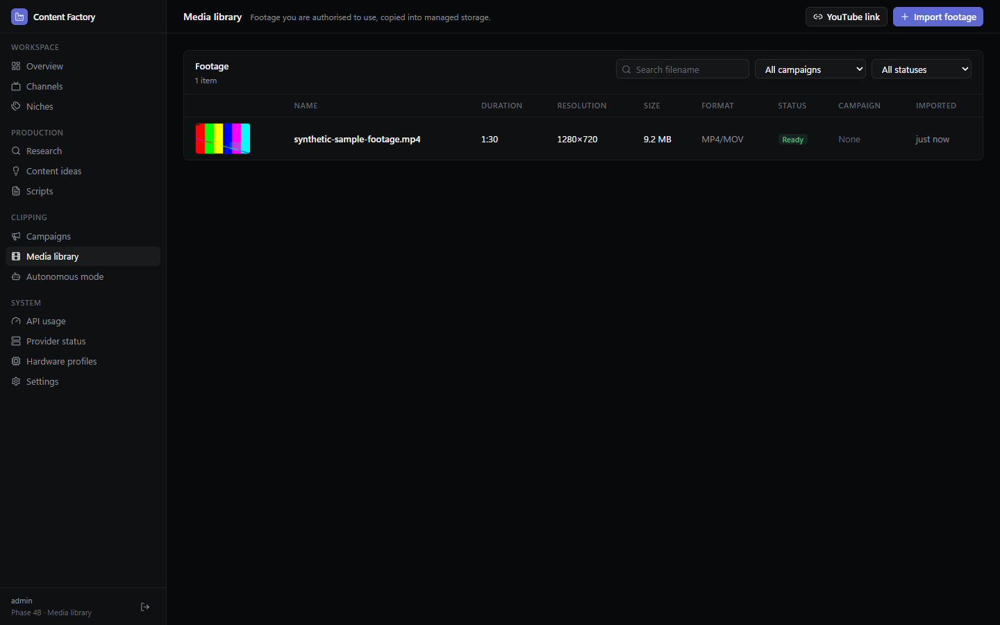

# Media acquisition

How footage gets into AI Content Factory, and exactly what works today. This page is deliberately precise: **it does not
claim that any external downloading provider is fully operational.**

Facts below come from the private repository (inspected 2026-11-25), its own design records, and what was observed in the
running application during this review.

## 1. What works today, at a glance

| Route into the library | Status | How it was established |
|---|---|---|
| **Manual import from the import folder** (the user drops files and picks them in the dashboard) | **Works. Verified live.** | A synthetic video was imported through the dashboard: copied, hashed, probed, thumbnailed and published as *Ready*. Covered by tests. |
| **Autonomous folder source** (a sub-folder of the import folder is watched) | **Discovery works. Verified live.** The later automatic steps were not run. | A source was added in the dashboard; the check found the one settled video and recorded it as *Selected*. Autonomous mode was left **off** because it needs an AI provider key that was not configured. |
| **Direct video links** (HTTP download of a file the server returns without sign-in) | Implemented and tested with mocks. **Not run live here.** | Unit and integration tests; no real download was performed in this review. |
| **RSS or Atom feeds with video enclosures** | Implemented and tested with mocks. **Not run live here.** | As above. Entries without a video file, and audio-only podcasts, are marked unavailable. |
| **YouTube channel discovery** (official Data API) | Implemented; tested against **mocked** API answers only. **Never run against the real API.** Needs an API key. | The project's own record states this. |
| **YouTube video download** | **Does not exist, by design.** | See section 5. |
| **YouTube link request** (paste a link) | **Metadata and link validation only.** The request waits for a video file the user supplies. | Implemented and tested; not run against the live API here. |
| **Other platforms** (Twitch, Instagram, TikTok, and so on) | **Not built.** | No provider exists. |
| **Selective (range-only) download** | Exists in the provider contract, planner and fetch job, **proven only with a test double**. No real provider can offer it today. | Tests. |

In short: the only acquisition routes shown working in a running application are *files the user supplies*. Automated
network downloading is implemented for plain HTTP links and feeds but was **not exercised against real servers** in this
review, and there is no downloader for any streaming platform.



## 2. Acquisition architecture

Two separate things are decided independently and never inferred from one another:

- **Rights.** The user's statement that they may use the footage (their own, licensed, provided by a campaign, or other).
  It is required before anything is acquired automatically, and it is recorded on each library item.
- **Acquisition capability.** Whether there is a *permitted technical way* to obtain the file. This is decided per video by
  the source adapter or provider, and may be: plain HTTP download, local import, or *not supported* (discovered only).

A third value, **reuse status** (unknown, permitted, not permitted), is information for the user. Acquiring a video is never
treated as permission to publish it, and nothing in the application publishes.



## 3. Provider abstraction

Two abstractions exist, at different levels.

**Source adapters (autonomous mode).** One adapter per source type validates its configuration, lists videos, and says how
each could be acquired. Implemented adapters: folder, direct links, RSS/Atom, YouTube channel (discovery only).

**Source providers (link requests).** A small contract keeps platforms out of the core pipeline:

- A provider reports its *real* capabilities (can it do a full download? a selective, range-based fetch? or only accept a
  user-supplied file?), validates links offline, and returns structured errors with stable codes.
- A **planner** chooses the method from the capabilities: selective only if the provider declares it *and* valid ranges
  exist; full download only if declared; otherwise *supplied file*; otherwise the request is refused with a reason.
- A failed selective fetch may continue as a full fetch only if the provider permits full downloads and the failure was not
  a refusal (access denied, private, DRM, age or region restriction). A refusal is reported as it is and never retried more
  widely.
- Adding a platform means subclassing the provider, reporting its real capabilities and registering it. The planner, queue,
  importer, pipeline and dashboard need no change. **Only YouTube is implemented; nothing exists for any other platform.**

## 4. Downloading actual media

Where a download is performed (direct links and feeds in autonomous mode), it runs as a job on the persistent media queue
and uses the same hardened fetcher as the rest of the product:

- every address a name resolves to must be public; the connection is made to the validated address (so DNS rebinding cannot
  redirect it), and every redirect hop is checked again;
- `robots.txt` is honoured; credentials in URLs, unusual IP spellings and non-standard ports are refused;
- the content type must be an allowed video type, with a byte limit; the file is streamed to disk and **resumes** with an
  HTTP `Range` request after an interruption;
- paywalled, DRM-protected or sign-in-only content is refused by the server (HTTP 401 or 403) and **never worked around**.
  No cookies, credentials or sign-in tokens are sent by any adapter;
- the downloaded file lands in a separate application-owned folder, never in the user's import folder.

## 5. YouTube: exactly what is and is not implemented

| Question | Answer |
|---|---|
| Can the application download a YouTube video? | **No.** YouTube offers third-party applications no download method and its terms do not allow downloading outside its own features. No stream extraction, cookie use or circumvention exists anywhere in the code. |
| What does a pasted YouTube link do? | The link is parsed offline (only YouTube hosts, one video id, no playlists or searches), and only a canonical link is stored. Metadata (title, channel, length, availability) comes from the **official Data API** if a key is configured; without one the link is still accepted and the page says the details were not looked up. |
| Then how does footage arrive? | The request waits (`awaiting_footage`) until the user places the actual video file (for example their own export, or a file a rights holder gave them) in the import folder. It then goes through the normal pipeline. |
| Can it get a transcript before footage exists? | No. |
| YouTube channel discovery in autonomous mode | Uses the official Data API; discovered videos are marked **unavailable** for acquisition. Tested against mocked API answers only. |

## 6. Importing into the library

Every route ends in the same importer, a job of kind `footage.import`:

```
import folder (read only) → copy to staging + SHA-256 → duplicate? → ffprobe the copy → thumbnail → publish atomically → ready
```

- **Copy, never move.** The inbox is read only; nothing in it is moved, changed or deleted.
- **Content-addressed storage.** The managed file is named after its hash, so identical bytes are stored once and a crash
  between "file published" and "database updated" is repaired by the retry finding the same file.
- **Only the application builds paths.** The API accepts *names of files inside the import folder*, never paths.
- **All-or-nothing.** A record becomes *Ready* only inside the transaction that records the validated file, and a database
  check constraint makes a half-imported file unable to be Ready.



## 7. Media validation and integrity

The file extension is only a pre-filter; the copy is judged by its content with ffprobe (with network protocols disabled so a
crafted playlist cannot make it open URLs):

- supported containers: MP4 and MOV family, and Matroska or WebM; images, playlists and audio-only files are refused;
- a real video stream (cover art does not count), a finite positive duration, a resolution between 16 and 16,384 pixels per
  side, and an allow-listed codec name;
- limits: 20 GB per file, 12 hours, 64 streams (configurable);
- frame rate is read, never assumed; variable frame rate and rotation are detected; a missing audio track is allowed;
- **integrity** is checked by SHA-256 at copy time, by size and header checks on downloaded files (regular file, non-empty,
  within the limit, starts like a known container), and by the content-addressed name.

Limit of the validation: it is **metadata-level**. A full decode pass that would catch corruption inside a file with intact
headers is not done, because it would cost as much as reading the whole file at encode speed. Nothing is transcoded on
import and the original is never modified.

## 8. Retry and failure handling

| Mechanism | Behaviour |
|---|---|
| Job attempts | Handler errors are retried with back-off up to a budget (three by default; four for a provider fetch), then the job fails with a stable code. |
| Interruptions | Restarts and crashes are counted separately so a normal restart never spends a retry; a file that keeps killing the process stops after three. |
| User restarts | At most five user (re)starts per link request, then `retry_exhausted`. Nothing retries forever. |
| Autonomous retry | An item that fails goes to `retry_pending` with a 30-minute back-off times the attempt number, up to the per-video attempt limit. |
| Consecutive failures | After five acquisition failures in a row, autonomous mode pauses itself. |
| Failure after the file is stored | Transcription, discovery and rendering failures **keep the stored source**; Retry resumes from the failed step and never imports or fetches again. |
| Cancel | Stops the request's own jobs, removes partial downloads, and keeps a source that was already stored. |
| Low disk | The job waits without spending an attempt. |
| Stable failure codes | Include invalid URL, unsupported source, video unavailable, unsupported method, access denied, acquisition timeout, partial file, corrupt media, audio-only, missing video, invalid duration, unsupported codec, insufficient storage, and retry exhausted. |

A request is `completed` **only** when at least one clip rendered and validated. "Nothing worth clipping" is `ready` with its
reason, not a fake success. Progress percentages appear only when a job really reports bytes; otherwise the interface shows
words, never an invented number.

## 9. Source retention

After a successful import the library original is *retained*. The user can keep it, or delete **only the managed original**
(with confirmation): the library row, thumbnail, transcript, moments and rendered clips stay and stay playable. Supplying the
same file again restores the original. Deletion is refused when something else uses the footage. The user's own inbox file is
never touched, and no source is deleted automatically.

## 10. Current provider integration status

| Item | Status |
|---|---|
| Manual import | Working (verified live) |
| Folder source discovery | Working (verified live) |
| Folder source import, transcription, moments and rendering run automatically | Implemented; **not run** in this review (needs a provider key) |
| Direct links and RSS | Implemented, mock-tested, **not live-tested** |
| YouTube metadata and channel discovery | Implemented, mock-tested, **never run against the real API** |
| YouTube download | **Does not exist, by design** |
| Any other platform | **Not built** |
| Selective acquisition | Contract and planner only; no real provider supports it |
