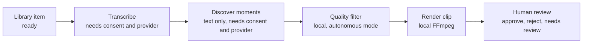
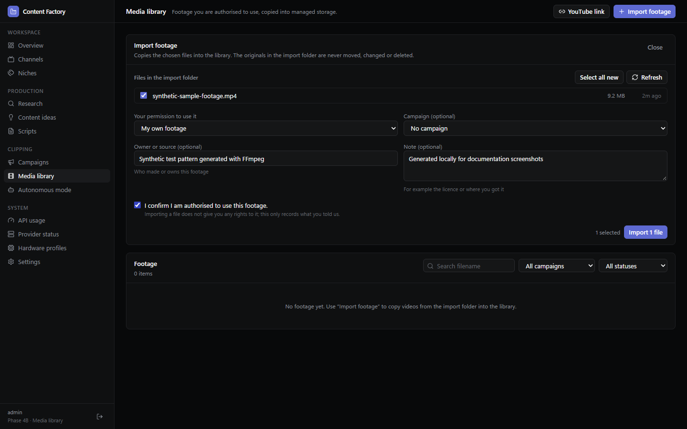
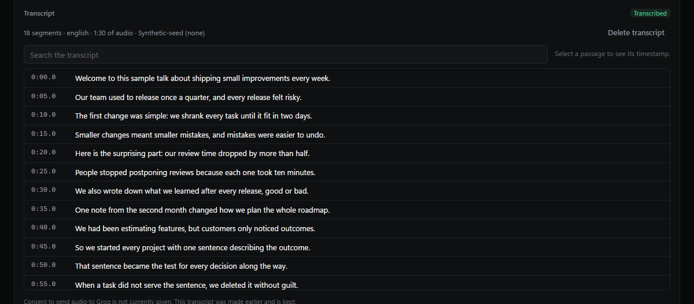
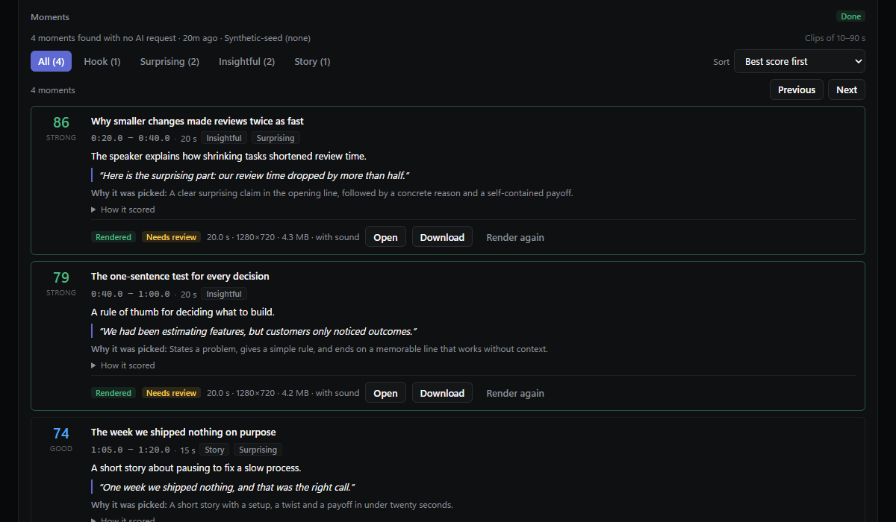
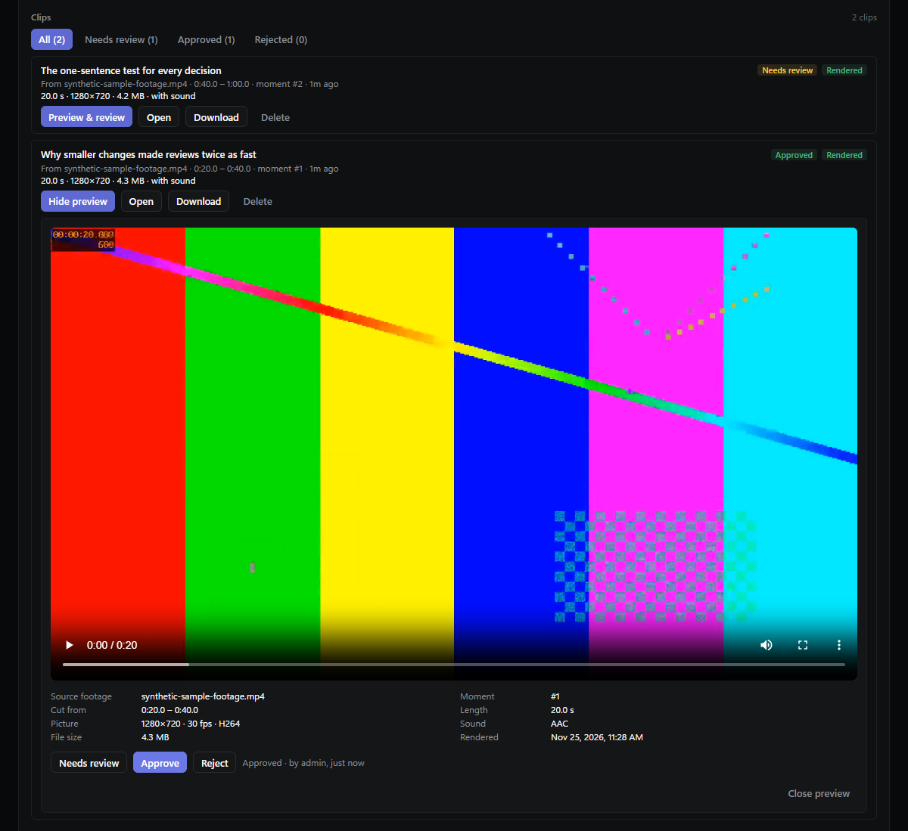
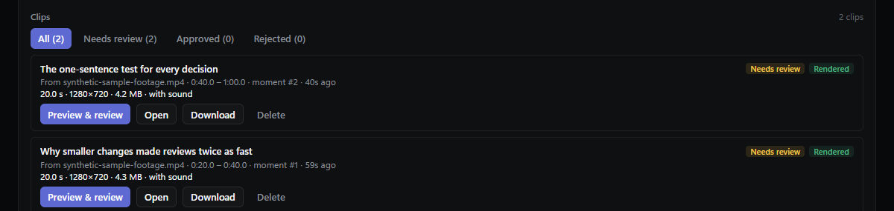

# Processing pipeline

How footage becomes reviewed clips: ingestion, transcription, moment discovery, quality filtering, clip generation and
storage. Every stage runs as a job on the persistent media queue (see [QUEUE_AND_ORCHESTRATION.md](QUEUE_AND_ORCHESTRATION.md)).

## What was verified live, and what was not

| Stage | Verified in the running application during this review | Otherwise |
|---|---|---|
| Ingestion (import, hashing, validation, thumbnail) | **Yes.** A synthetic 90-second video was imported through the dashboard. | Automated tests |
| Transcription | **No.** It needs a provider key and consent; none was configured, so no audio left the machine. | Automated tests with a scripted fake provider |
| Moment discovery | **No**, for the same reason. | Automated tests with a scripted fake model |
| Quality filtering | **No.** It runs inside autonomous mode, which was left off. | Automated tests |
| Clip rendering with real FFmpeg | **Yes.** Two clips were rendered, previewed in the page and one was approved. | Automated tests with real FFmpeg |
| Review (approve, reject, needs review) | **Yes.** | Automated tests |

The transcript and moment screenshots therefore show the **real interface displaying synthetic records** that were written
directly into the isolated demo database, labelled "Synthetic-seed" in the interface. The project's own tests use the same
technique. The scores on those sample candidates are illustrative and were not computed by the model or the scoring
formula. The footage itself is a generated test pattern with a tone, so its picture does not match the sample transcript.

The project's own verification record (2026-11-17) states that no real provider request had been sent at that date. Live
transcription and discovery against Gemini or Groq are therefore **implemented but not verified end to end**.

## 1. Media ingestion

Covered in [MEDIA_ACQUISITION.md](MEDIA_ACQUISITION.md#6-importing-into-the-library). In short: copy, SHA-256, duplicate
check, ffprobe validation, thumbnail, atomic publish, with a rights record and an optional campaign link. The import form
makes the rights statement explicit and separate from any permission to upload.

## 2. Transcription

- **Consent first.** Sending audio to a provider needs the user's explicit consent **for that footage**, given in the
  footage's panel and revocable. It is not the same as the import-time rights tick. The backend enforces it three times: when
  requested, when the job starts, and before every chunk.
- **Chunked audio.** FFmpeg extracts the first audio track as mono, 16 kHz FLAC in chunks of at most ten minutes (one chunk on
  disk at a time), each well under the provider's documented upload limit. A chunk over the limit is refused before upload.
- **Provider call.** Each chunk goes through the provider manager (Groq Whisper; quotas, circuit breaker and bounded retries
  apply) and the chunk file is deleted straight after. Finished chunks are saved in the job's checkpoint, so a restart resumes
  after the last chunk.
- **Assembly.** Segment times are shifted by chunk offset and everything is written in **one** transaction; a transcript is
  `completed` only inside that transaction, so a completed transcript is always whole.
- **Privacy.** No response, job record, audit entry or log carries an API key or an absolute path. Withdrawing consent cancels
  a queued or running transcription; it cannot recall audio already sent, and the interface says so.

*Synthetic sample transcript (see the note above).*

## 3. Moment discovery

- **Text only.** Only transcript text is sent, as delimited untrusted data; never the video, audio, file name or path. It uses
  the same per-footage consent and only the provider consented to (the usual text fallback is switched off here so transcript
  text can never reach a provider the user did not agree to).
- **Windows.** The transcript is split into overlapping windows (by default about 15 minutes of speech or 18,000 characters,
  overlapping by 90 seconds). A short video is one window and one request.
- **The model never writes timestamps.** It returns the first and last *segment number* of each moment; times come from the
  stored transcript plus a small pad, clamped to the footage. A moment cannot start or end where nobody speaks.
- **Local validation drops, never repairs.** A suggestion is discarded if a field is missing, segment numbers are invalid, no
  category is recognised, any score is missing or out of range, the moment lies beyond the footage, is longer than the maximum
  (never trimmed, since that could cut the payoff), or is too short and cannot be extended with real following passages.
- **Consolidation.** Duplicates from overlapping windows are merged locally and the best candidates are kept.
- **Categories:** hook, funny, surprising, insightful, emotional, story, debate.
- **Score.** Seven judgements (hook, payoff, standalone, context, emotion, entertainment, information) come from the model; the
  stored score is a fixed, visible formula and the breakdown is shown. The score **ranks moments within one video; it is the
  AI's judgement, not a measurement and not a prediction of views.**
- **Atomic results.** Candidates are written only in the transaction that marks the run `completed`; a result is never
  analysed again unless the user asks for new moments.

*Synthetic sample candidates (see the note above). Rendered clips show a "Rendered" badge and a review state.*

## 4. Quality filtering

Part of **autonomous mode** (manual clipping leaves selection to the user). For every candidate a local check, with **no AI
call**, measures from the timed transcript: whether it starts or ends mid-sentence, lead-in silence, dead air, words per second,
repetitiveness, filler words, transcription confidence, duration fit, the model's own standalone and context sub-scores,
and overlap with a better candidate.

The quality score (0-100) is a weighted combination (about 40% model score, 20% structure, 25% speech, 15% duration). A
candidate passes at a minimum quality (default 55) with no hard flag (too short, too long, too little said, duplicate). The
best few passing candidates (default three per video) are rendered; held-back candidates stay inspectable. The score filters
obviously weak clips; **it does not predict views.**

## 5. Clip generation and FFmpeg processing

A render creates a clip record and a job; the job then runs, entirely **locally**: no AI call, no upload, no cost.

| Setting | Value | Reason |
|---|---|---|
| Container | MP4, index at the front (`faststart`) | Plays everywhere; browsers can start and seek at once |
| Video | H.264 (libx264), High profile, `yuv420p`, CRF 20, preset `veryfast` | Most compatible encoder; deliberate CPU encoding for a reliable baseline |
| Audio | AAC-LC, 160 kb/s, stereo, 48 kHz | Universally supported |
| Size | Source size after rotation, longest side capped at 1920, even dimensions, never upscaled | No cropping in this phase |
| Frame rate | Kept; variable-frame-rate sources written at a constant rate | Keeps audio and picture in sync |
| Metadata | Source tags, chapters and subtitles dropped | A clip never leaks the source's camera or location tags |
| Priority | Below normal, limited threads | The computer stays usable |

**Timestamp accuracy.** The candidate's stored times are the only source of truth and are never adjusted. The cut is always a
re-encode, never a stream copy (a copy can only start on a keyframe and leaves undecodable lead-in frames). The input is
seeked before decoding and everything before the exact start is dropped, for picture and sound.

**Output validation.** A zero exit code is never enough. The staged file is probed and must have the planned size, MP4
container, H.264 in `yuv420p`, no rotation tag, a known frame rate, a duration within a small tolerance of the plan, and AAC
audio if (and only if) the source had audio. Otherwise the render fails with a sanitised reason and the staged file is
removed.

## 6. Result storage

- The clip is written to a staging area on the same volume, validated, then **renamed** into the clips folder as
  `<random id>.mp4`. No user text reaches a file name, and the rename never replaces an existing file.
- Footage originals, staging and FFmpeg scratch are separate folders; the import folder is never written.
- The database row becomes `completed` in one transaction that also records the validated size, codecs and resolution.
- A re-render is a new row and a new file, never an overwrite. Deleting a clip removes its row and file, never the footage.
- Start-up removes clip files that no row refers to.
- Files are served with range support and `no-store` caching, and only if they resolve inside the library.

## 7. Review

A completed render starts as *needs review*. The dashboard plays the clip in the page, shows its facts, and records a verdict
(approved, rejected or needs review) separate from the render status. Nothing is published or uploaded.

*Observed live: a real FFmpeg render of a 20-second moment, previewed in the page and approved. The burned-in timestamp
in the test pattern shows the cut starts at 20 seconds.*

