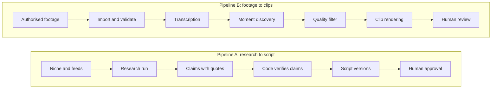
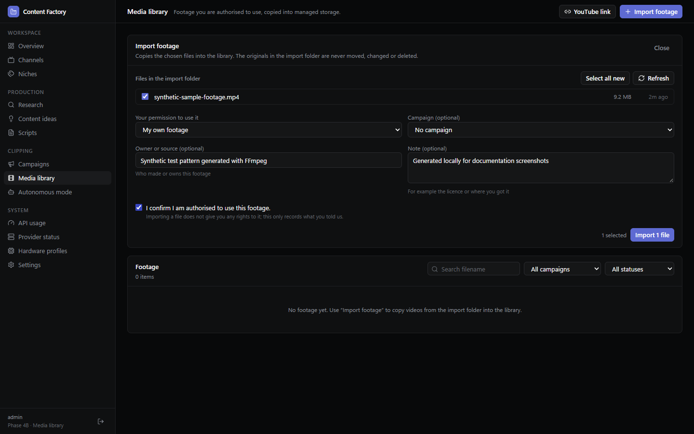
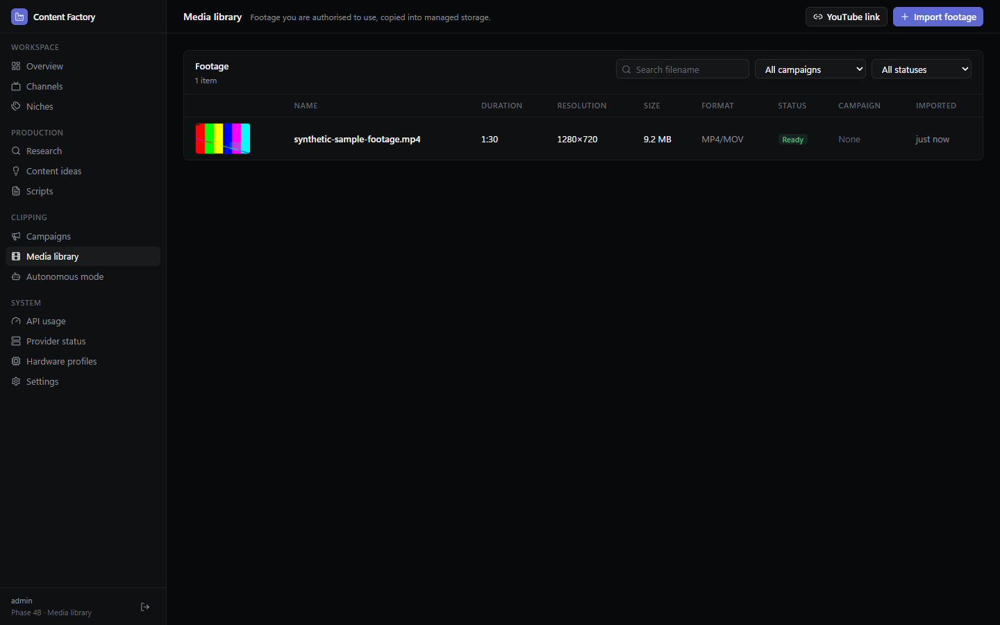
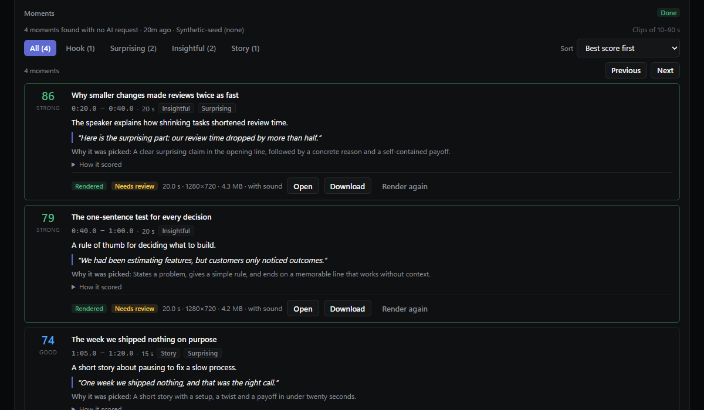
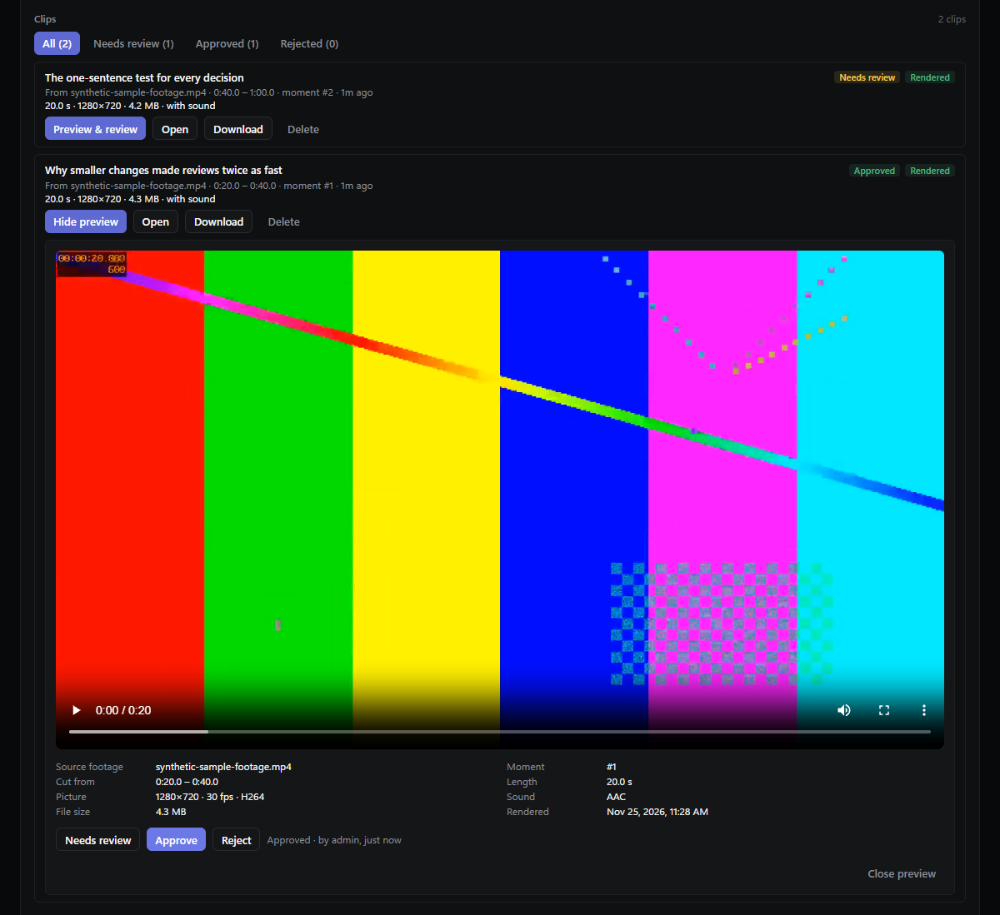

# Product overview

> **AI Content Factory** is a local-first platform for turning research into reviewed scripts and long footage into
> reviewed short clips, with a human approving every step that matters. This page describes what the product does today,
> based on the running application and its private repository as inspected on 2026-11-25.

It is **not** a one-click AI video generator. It is a set of connected engines (research, claim verification, scripting,
media import, transcription, moment discovery, rendering, source acquisition and autonomous orchestration) built around
one principle: nothing is published, uploaded or sent to an external service without a person's explicit decision.

## 1. Vision

Short-form video at scale needs two different kinds of work. One is *creating* content from knowledge: finding topics,
checking facts and writing scripts. The other is *clipping* content from existing footage: finding the best moments in
long recordings and turning them into watchable clips. Both are slow when done by hand and risky when automated blindly,
because language models state things sources never said, and automated downloading can break platform terms or ignore who
owns the footage.

The product's vision is to automate the mechanical parts, keep the judgement with a person, and be explicit about
evidence, rights and cost.

## 2. The problem it addresses

| Problem | How the product responds |
|---|---|
| AI-written scripts can contain unsupported statements | Every claim is stored with its source URL and a verbatim quote, and **code** checks the quote against the retrieved text. Only usable facts reach a script. |
| Finding good moments in hours of footage is slow | The footage is transcribed and a language model proposes timestamped, scored candidates with the reason for each. |
| Automation tends to run unattended and unaccountably | Everything lands in a review queue. Approval is required before anything leaves the system; nothing is published. |
| Platform and rights risk | Rights, acquisition capability and reuse status are recorded separately; the application never downloads from services that do not permit it. |
| Paid-API surprises | A "zero paid API" mode calls a provider only if the user declared its key free-tier; over-quota requests pause instead of charging. |
| Long jobs fail and lose work | A persistent job queue survives restarts, with retries, pause, cancel and recovery. |

## 3. Target users

- **Individual creators and small teams** running several short-form channels from one Windows computer.
- **Clippers** working with footage they are authorised to use (their own, licensed, or provided by a campaign).
- **Engineers and reviewers** evaluating the architecture: the product is designed to run on a single desktop with no GPU,
  no Docker and no paid services.

## 4. Main capabilities

| Capability | What it does | Status |
|---|---|---|
| Channels and niches | Organise channels and the topics each covers, with editorial rules that prevent a topic being reused across channels without a different treatment | Implemented |
| Research | Collects topics from configured feeds, de-duplicates across channels, fetches article text politely, scores ideas | Implemented |
| Claim verification | Source-quoted claims checked in code; separates verified facts from AI assumptions | Implemented |
| Script generation and review | Versioned scripts that cite fact ids; deterministic checks; edit, regenerate, approve; approvals cannot outlive a change | Implemented |
| Campaigns | Manual records of creator-authorised clipping campaigns, with rules versioning | Implemented |
| Media library | Imports authorised footage, hashes, validates and describes it; duplicate detection; per-footage rights record | Implemented |
| Transcription | Timestamped transcripts through a provider, with per-footage consent | Implemented; verified with fakes only |
| Moment discovery | Scored, timestamped clip candidates with titles, opening lines and reasons | Implemented; verified with fakes only |
| Clip rendering and review | Local FFmpeg cuts, validated output, in-page preview and verdicts | Implemented and **observed working** |
| Source links (YouTube) | Link validation and metadata; the request waits for a supplied file | Implemented (metadata only; **no download by design**) |
| Autonomous mode | Background scheduler that discovers, selects, acquires permitted videos and runs the pipeline | Implemented; early; see [MEDIA_ACQUISITION.md](MEDIA_ACQUISITION.md) |
| Provider management | Gemini and Groq adapters with fallback, quotas and circuit breakers | Implemented; **no live provider request recorded** |
| Captions, reframing, export, publishing | | **Not built** |

## 5. Product workflow

The product has two pipelines that share infrastructure.

Pipeline A ends at an approved script. Turning an approved script into a video (voiceover, scenes, export) is **not
built**. Pipeline B ends at a reviewed clip file in the library. Nothing is published by either pipeline.

### Pipeline B as it appears in the dashboard

1. **Import.** The user drops files into an import folder and picks them in the dashboard, recording the basis on which
   they may use the footage.
   
2. **Library.** The file is copied, hashed, validated with ffprobe and given a thumbnail.
   
3. **Transcript and moments.** A transcript is produced (with per-footage consent) and moments are proposed.
   
4. **Render and review.** Chosen moments are cut locally with FFmpeg, previewed in the page, and approved or rejected.
   

> **About the transcript and moment screenshots.** No AI provider key was configured for the screenshot session, so
> **no provider was called**. The transcript text and the four moment candidates shown are *synthetic sample records
> written directly into the isolated demo database* (the same technique the project's own tests use), labelled
> "Synthetic-seed" in the interface. The import, thumbnail, FFmpeg rendering, preview and approval steps were real. See
> [PROCESSING_PIPELINE.md](PROCESSING_PIPELINE.md#what-was-verified-live-and-what-was-not).

## 6. Current development status

Status vocabulary used throughout this repository:

| Label | Meaning |
|---|---|
| **Verified live** | Performed in the running application during this review |
| **Verified by tests** | Covered by an automated test run on 2026-11-25 (or by the test results recorded in the project) |
| **Implemented, not verified end to end** | Code exists and is unit-tested with fakes; never run against the real external service |
| **Partial / Under development** | Some of it works |
| **Not built** | Absent or schema only |

| Area | Status |
|---|---|
| Local API, database, migrations (12), backups, health checks | Verified live and by tests |
| Admin authentication | Verified live (sign-in) and by tests |
| Footage import and media library | Verified live and by tests |
| Clip rendering and review | Verified live and by tests |
| Autonomous folder-source discovery | Verified live (one synthetic video discovered) |
| Autonomous end-to-end run (select, acquire, transcribe, find moments, render) | **Not run** (needs a provider key) |
| Transcription and moment discovery against a real provider | **Implemented, not verified end to end** |
| Research and script pipeline against real feeds and a real provider | **Implemented, not verified end to end** |
| Direct-link and RSS acquisition | Implemented and tested with mocks; **not run live** here |
| YouTube | Link validation and metadata only; no download by design |
| Other platform providers (Twitch, Instagram, TikTok) | **Not built** |
| Captions, reframing, export, publishing | **Not built** |
| Voiceover, video assembly, analytics | **Not built** (schema tables exist; no code uses them) |

The application's version label is **0.3.0**. It is under active development and not publicly released.
