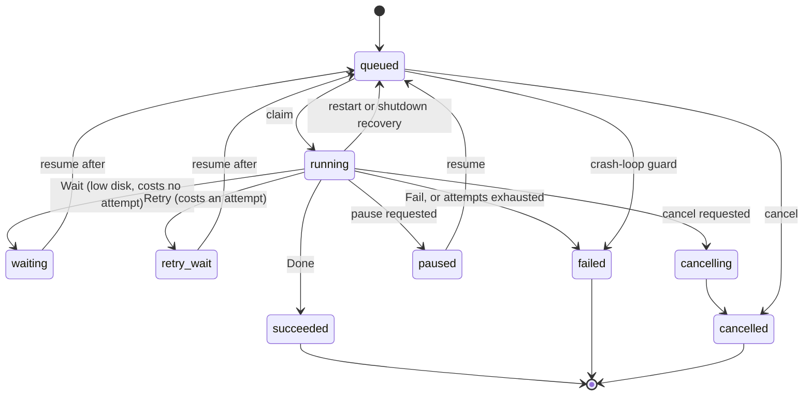
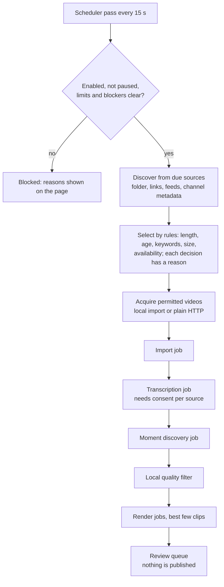
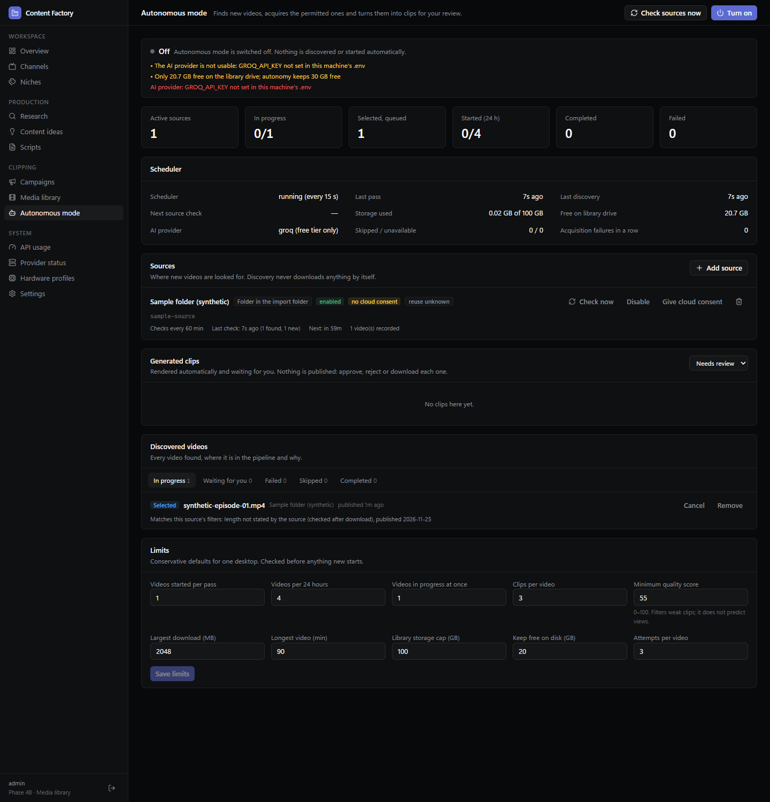

# Queue and orchestration

How work is queued, run, recovered and scheduled. Only implemented capabilities are described; the private repository's design
records are the source, and the scheduler and import path were observed running during this review.

## 1. Two persistent queues

| Queue | Table | For | Concurrency |
|---|---|---|---|
| **Media job queue** | `media_jobs` (+ `media_job_dependencies`) | Local file and FFmpeg work | One worker thread, **one job at a time** |
| **AI task queue** | `ai_tasks` | Provider calls for research and scripts | One background worker polling every few seconds |

They are separate on purpose: AI calls never run on the media worker, and media handlers reach providers only through the
provider manager (see [AI_PROVIDER_ARCHITECTURE.md](AI_PROVIDER_ARCHITECTURE.md)). Both live in the database, so a restart
loses nothing.

Job kinds registered on the media queue: `footage.import`, `transcribe.media`, `discover.moments`, `render.clip`,
`source.acquire` (autonomous download), `acquisition.fetch` (provider fetch) and `selftest.encode`.

## 2. Media job lifecycle

Key rules:

- **Two budgets.** `attempts` counts handler errors (default three). `interruptions` counts restarts and crashes (default
  three). A normal restart never burns a retry; a file that keeps killing the process stops after three interruptions with a
  `crash_loop` code.
- **Idempotent submission.** The same `(kind, target, parameters)` can be active only once, enforced by a partial unique index
  in the database. Submitting it again returns the existing job.
- **Priority.** Higher first, then oldest (interactive work 100, final renders 50, analysis 10).
- **Queue cap.** A configured maximum number of queued jobs; a full queue refuses new work (HTTP 429).

## 3. Pause, resume, cancel and retry

| Action | Behaviour |
|---|---|
| **Pause** | Honoured at a handler's safe points, never in the middle of an FFmpeg run. To stop FFmpeg immediately, cancel. |
| **Resume** | Moves a paused job back to the queue. |
| **Cancel** | Final. A job that finishes after cancel was requested is recorded as cancelled and its result discarded. A cancel that races an outcome write always wins. |
| **Retry** | Re-queues a failed or cancelled job; for clips and discovery runs the retry is claimed atomically so of several simultaneous retries exactly one wins. |

Cancel, wall-timeout and stall-timeout all end a child process the same way: a graceful `q` on stdin, a grace period, then the
whole process tree is killed.

## 4. Dependency management

A job runs only after everything it depends on has succeeded. Blocked jobs are excluded in the claim query itself, so any
number of blocked high-priority jobs cannot hide the runnable job they are waiting for. If a dependency fails or is cancelled,
its dependents are cancelled and can be submitted again. In practice the pipeline stages (import, transcription, discovery,
rendering) are chained by the services that create them, and an autonomous item continues "from the state of its jobs".

## 5. Restart recovery

| Situation | What happens |
|---|---|
| App stopped while a job ran | Shutdown stops the child, the job returns to the queue (interruptions + 1), temp files are removed |
| Backend killed or crashed | A Windows job object kills FFmpeg with it; on the next start the running job goes back to the queue and any orphan process is reaped **only if its pid, start time and executable all still match** |
| Crashed during a cancel | The next start finishes the cancel |
| Another backend instance owns a running job | Left untouched; this instance does not start a media worker |
| A leftover FFmpeg cannot be killed | The job is failed (`orphan_process`) rather than re-run beside the survivor |
| The worker could not save an outcome | Retried; if it still fails, the next scheduling pass settles the stranded row as interrupted |
| Checkpoints | Stage progress (finished transcription chunks, finished discovery windows, partial downloads) is saved and resumed |
| Database and files out of step | Handlers are written to be safe to run again from the start: a retry finds a published file, validates it and records it without redoing the work |

Ownership is explicit: a worker identity of machine, process and start time means a restart only takes over jobs whose owner is
provably gone, and a worker that loses ownership is told to stop and its late result is ignored.

## 6. Autonomous scheduling

Autonomous mode adds **one scheduler thread** (a pass every 15 seconds by default). It does no media work itself. Each pass it
discovers new videos from due sources, selects items by the user's rules, and starts the *next* step for items already in the
pipeline by creating ordinary jobs through the existing services.

Item lifecycle: `discovered → selected → acquiring → acquired → processing → clip_generation → completed`, plus `rejected`
(with the rule), `unavailable`, `failed`, `retry_pending` (30-minute back-off times the attempt number) and `cancelled`.

**Checked before anything new starts:** autonomy is enabled and not paused; videos started per pass, per 24 hours and in
progress at once (defaults 1, 4 and 1); free disk space and the storage cap; the AI provider is configured; no autonomous AI
job is waiting on a provider quota; and the media queue has free slots. A failing check shows as a *blocker* and the mode
becomes **Blocked**. Five acquisition failures in a row make autonomy pause itself.

*Observed live: Off (it needs a provider key); one folder source added; the one settled video found and recorded as Selected.
The screenshot also shows the blockers the page reports.*

**Pause and off.** Pause holds the autonomous mode's own queued jobs (jobs the user started by hand are never touched); a
running job stops at its next safe point. Turning it off stops new work; already-queued jobs finish.

**Restart.** Everything is in the database: the switch, sources, items and limits survive, the scheduler starts again, and every
item continues from the state of its jobs. Half-finished downloads of active items resume; other leftovers are removed.

**Duplicates.** A video is recorded once per source; the same URL from a second source is rejected as a duplicate; identical
bytes are recognised by the importer, and existing transcript, moments and clips are reused (no second upload).

## 7. Reliability mechanisms in one place

| Mechanism | Where |
|---|---|
| Idempotent submission, race-safe conditional updates | Media queue |
| Two retry budgets (attempts and interruptions), crash-loop guard | Media queue |
| Supervised child processes with kill-on-close, timeouts and stall detection | Process runner |
| Low-disk waiting, queue cap, memory cap option | Resource protection |
| Checkpoints and idempotent handlers | Transcription, discovery, rendering, downloads |
| Atomic publish (stage, validate, rename, then one transaction) | Import and render |
| Provider circuit breakers and quota waiting | Provider manager |
| Stuck-job detection that only reports, never cancels or retries | Observability |
| Machine lock and backups with checksums | System |
| Health and queue diagnostics (worker liveness, queue age, 24-hour failures by category) | Dashboard and API |

**Not implemented:** a Jobs page in the dashboard (job status appears inside the footage and clip panels and in the Overview
health list), a "pause all background media" switch, a second worker slot, and a watchdog that interrupts a hung Python
handler (every external process has timeouts, but a hung Python handler cannot be interrupted from inside the process).
