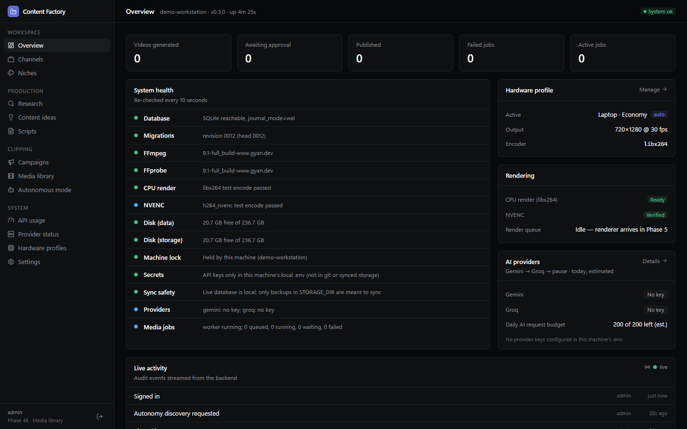
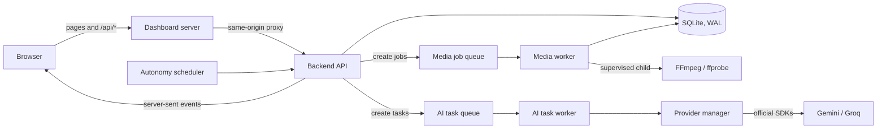

# System architecture

How AI Content Factory is put together. Everything here describes the architecture **implemented** in the private
repository (version 0.3.0) as inspected on 2026-11-25. Diagrams are in [`../architecture/`](../architecture/README.md).

## 1. Shape of the system

A single-computer, local-first application with two processes and one database:

| Component | Technology | Role |
|---|---|---|
| **Dashboard** | Next.js, React, TypeScript, Tailwind CSS | The only thing the browser talks to. Serves pages and acts as the sole same-origin proxy for `/api/*`. |
| **Backend API** | Python, FastAPI, served by uvicorn | Versioned REST routes under `/api/v1`, authentication, services, and background workers. |
| **Database** | SQLite in WAL mode, SQLAlchemy models, Alembic migrations | All state: configuration, content, queues, usage and audit records. |
| **Local tools** | FFmpeg and ffprobe | Media inspection and rendering, run as supervised child processes. |
| **External providers** | Google Gemini, Groq (official SDKs); YouTube Data API (metadata only) | Optional; used only with the user's own keys and consent. |

Scale indicators (counted 2026-11-25): about 24,000 lines of Python in the backend package, 72 TypeScript source files in
the dashboard, 42 database tables, 12 migrations and 16 API route modules.

## 2. Frontend architecture

- A Next.js application with one page per area: Overview, Channels, Niches, Research, Content ideas, Scripts, Campaigns,
  Media library, Autonomous mode, API usage, Provider status, Hardware profiles and Settings.
- The browser never calls the backend directly. A single route handler proxies `/api/*` to the backend, forwards an
  allow-list of headers (and none of the forwarding headers), refuses malformed or encoded paths, refuses cross-origin
  state-changing requests and oversized bodies, and never relays the shutdown endpoint. The backend address is read at
  runtime, so the session cookie stays first-party.
- Live status uses server-sent events (the Overview's activity feed) and periodic polling.
- Both services bind to the loopback address only. LAN access is intentionally unsupported.



## 3. Backend architecture

```
backend/
  api/v1/        REST routes: auth, system, settings, backups, events, providers, channels, content (research, ideas,
                 claims, scripts), campaigns, media, media-jobs, transcripts, moments, clips, acquisitions, autonomy
  auth/          password hashing, sessions, setup and control tokens, login throttling
  database/      models, engine (WAL), migrations, backup and restore
  providers/     provider interface, Gemini and Groq adapters, manager, quota manager, health, cache, AI task queue
  agents/        research, claim verification, topic selection, script generation and checks
  integrations/  SSRF-guarded HTTP fetch, robots.txt, RSS, text extraction, YouTube metadata
  media/         process runner, media job queue and worker, importer and library, transcription, moment discovery,
                 clip rendering
  acquisition/   provider contract, planner, YouTube provider, acquisition service
  autonomy/      source adapters, selection, quality filter, scheduler, orchestration
  campaigns/     campaign schemas and service
  system/        hardware and FFmpeg detection, profiles, health, machine lock, observability
```

(The names above are a map of responsibilities, not code. The backend's source is private.)

## 4. Engine separation

The product is several engines, each with its own responsibility, tables and tests, wired together through the database
and two queues rather than by direct calls.

| Engine | Responsibility | Talks to |
|---|---|---|
| Provider and quota engine | One interface to language-model providers; fallback, retry, quota and circuit breaking | AI task queue |
| Research engine | Topic collection, de-duplication, polite article fetching | Integrations, provider engine |
| Claim-verification engine | Source-quoted claims checked in code | Research engine |
| Script engine | Versioned scripts, deterministic checks, approval rules | Claim engine, provider engine |
| Media library engine | Import, validation, hashing, thumbnails, rights record | Media job queue |
| Transcription engine | Audio extraction, chunking, provider transcription | Media job queue, provider engine |
| Moment-discovery engine | Window the transcript, call the model, validate and score locally | Media job queue, provider engine |
| Clip-rendering engine | Exact cut, encode and validate | Media job queue |
| Source-acquisition engine | Provider contract and acquisition planning | Media job queue, media library |
| Autonomy engine | Scheduling, selection, quality filtering, orchestration | All media engines |
| Campaign management | Records of creator-authorised campaigns | Media library |

A **dormant placeholder** exists for a future video-production engine (an empty package). The schema also contains tables
for stages with no implementation yet (voiceovers, media assets, QC reports, publishing jobs, analytics snapshots): no
code outside the schema refers to them.

## 5. Database architecture

- **SQLite in WAL mode**, with a machine lock so two computers cannot open the same live database, and a rule that the
  live database and the credentials file are never synced between machines (only backups are).
- **42 tables** defined by SQLAlchemy models, grouped by purpose:

| Group | Examples |
|---|---|
| Identity and settings | users, auth sessions, system settings, audit log |
| Content | channels, niches, content ideas, research sources, research claims, scripts, scenes |
| Providers | provider usage, quota records, cost records, AI tasks, provider cache |
| Campaigns | campaigns |
| Media | media jobs, job dependencies, media files, transcripts, transcript segments |
| Discovery and clips | moment discovery runs, moment candidates, rendered clips |
| Autonomy and acquisition | content sources, discovered items, autonomy state, moment quality, source acquisitions |
| Present in the schema, no implementation yet | voiceovers, media assets, video jobs and versions, QC reports, approvals, publishing, analytics |

- **Integrity is enforced in the database**, not only in code: check constraints (for example a media file can be `ready`
  only if its hash, size, duration, resolution and codec are all recorded), partial unique indexes (content hash is unique
  among ready files; one active render per candidate and profile; one active discovery run per footage), and foreign keys
  with deliberate delete behaviour.
- **12 Alembic migrations** (`0001` to `0012`), one per development phase. They run automatically at backend start; the
  documentation says to take a backup before upgrading, and the Overview shows the migration revision against the head.
- **Backups** are consistent, include a checksum manifest, and restores validate integrity, schema and checksum before
  migrating forward.
- **No absolute paths are stored.** Paths are relative to configured roots or generated from hashes and ids.

## 6. Job orchestration

Two persistent queues with different purposes:

| Queue | For | Workers |
|---|---|---|
| **AI task queue** (`ai_tasks`) | Provider calls (research briefs, scripts) | One background worker polling every few seconds; tasks pause and resume around quotas and failures |
| **Media job queue** (`media_jobs`) | Local FFmpeg and file work: import, transcription, moment discovery, clip rendering, acquisition | One worker, one job at a time |

Autonomous mode adds a **scheduler thread** that does not do work itself: it decides what to start next and creates
ordinary jobs through the same services. See [QUEUE_AND_ORCHESTRATION.md](QUEUE_AND_ORCHESTRATION.md).

## 7. Communication between components



Components communicate through the database (state and queues) and synchronous HTTP; there is no message broker.
Provider calls are made only by the AI task worker and by media handlers that go through the provider manager.

## 8. Failure handling

| Failure | Handling |
|---|---|
| Backend or computer stops while a media job runs | Shutdown stops the child process and re-queues the job; after a crash, a Windows job object has already killed FFmpeg, and startup re-queues the job and reaps any orphan by identity |
| A job keeps killing the process | An interruption budget parks it as failed with a crash-loop code |
| Handler error | Retried with back-off up to an attempt budget, then failed with a redacted message |
| Low disk space | The job waits (costing no attempt) and is re-checked every minute |
| Provider rate limit or quota | The task or job waits until the retry time; it does not fail |
| Provider outage | Retries, then the circuit breaker opens, the next provider is tried, and if none can serve the task is paused |
| Malformed model output | Counted by the breaker and falls back; after repeated bad output the task fails permanently |
| Two requests race (cancel, retry, claim, outcome) | Conditional updates with row counts checked; a cancel that lands while an outcome is written wins |
| FFmpeg finished but the database save failed | The retry finds the published file, validates it and records it without rendering again |
| Another backend instance owns a running job | Left untouched; this instance does not start a media worker |
| Missing consent, rights or configuration | Treated as a visible state with an explanation, not a failure |

Health checks cover the database, migrations, FFmpeg and ffprobe, encoders (each verified by a real test encode), disk
space, machine lock, secrets handling, providers and the media worker; the Overview page re-checks them every ten seconds.

## 9. Security architecture (summary)

Loopback-only binding, a Host-header allow-list against DNS rebinding, administrator authentication with scrypt-hashed
passwords and `HttpOnly`, `SameSite=Strict` session cookies (only the token's SHA-256 is stored), login lockout, security
headers on every response, an SSRF-guarded fetcher with DNS pinning for all outbound requests, and API keys that live
only in the local `.env` file and are scrubbed from logs. The backend deliberately ignores forwarding headers. See the
project's hardening notes for the decisions; implementation specifics are not published here.
